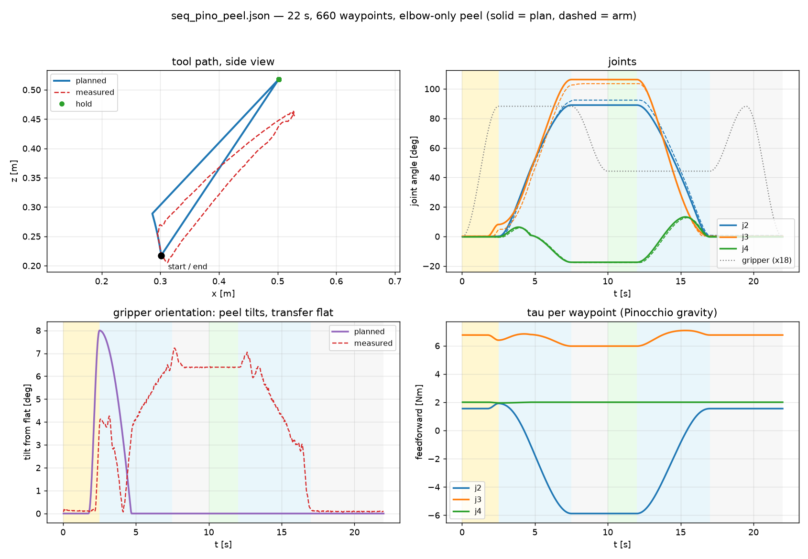
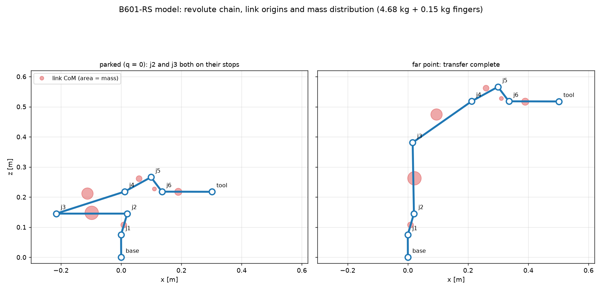

# B601-RS trajectory pipeline

One trajectory, two machines, one hand-off.

```
edge-rust/     the edge player: one static Rust binary (Raspberry Pi Zero W + MCP2515 HAT)
host/          planning runs in a Docker container (Pinocchio has no Windows wheels)
trajectories/  the hand-off: joint-space JSON with gravity feedforward
```

Why the split: `motorbridge` has no armv6l wheels and a damping-least-squares IK
solve costs ~1.3 s on a Pi Zero W, so **all planning happens off the board** and
the edge only ever sends joint angles and torques it was handed.

## The loop

```
  edge-rust dump          host/plan_with_pinocchio.py (container)        edge-rust
arm ───────────► current.json ──────────────────────────────► seq.json ───────────► arm
     (read 0x7019,          (their IK + Pinocchio g(q),         (30 Hz frames,
      no torque)             one tau per waypoint)               dry run by default)
```

```bash
# 1. edge: snapshot where the arm is (read-only)
./rebot-edge dump --ids 1,2,3,4,5,6,7 > current.json

# 2. host: plan with Seeed's stack, inside the container
docker build -t rebot-pino -f examples/host/Dockerfile.pinocchio .
pwsh -File examples/host/repeat_pino.ps1            # plan and save

# 3. edge: replay it (dry run first)
./rebot-edge trajectories/seq_pino_peel.json
sudo ./rebot-edge trajectories/seq_pino_peel.json --execute --track
```

On a POSIX host, the container can be run with a bind mount instead of
`docker cp`:

```bash
docker run --rm -v "$PWD:/work" rebot-pino python \
    /work/host/plan_with_pinocchio.py --joints /work/current.json --out /work/seq.json
```

## Build the Rust player

```bash
# from the repository root; ARMv6 static binary for a Pi Zero W
docker build --target bin --output examples/edge-rust/dist examples/edge-rust
scp examples/edge-rust/dist/rebot-edge pi@raspberrypi.local:~
```

Other targets (armv7, aarch64, x86_64) and every option are in
[`edge-rust/README.md`](edge-rust/README.md).

`rebot-edge dump` is the read-only pose snapshot: it reads parameter `0x7019`
from each motor and prints JSON. It enables nothing and sends no torque.
`rebot-edge` with a trajectory JSON is the player; `--execute` is the gate and
`--check` validates a file without touching CAN.

## The trajectory

`trajectories/seq_pino_peel.json` — 22.00 s, 660 waypoints at 30 Hz, motors 1-7:

| phase | time | what happens |
|---|---|---|
| peel + jaws open | 0 - 2.5 s | elbow +8° lifts the arm off its stop while the jaws open to 4.90 rad |
| transfer | 2.5 - 7.5 s | straight line +0.20 m forward, +0.30 m up, gripper held flat |
| close | 7.5 - 10 s | jaws to 2.46 rad (6 cm) |
| hold | 10 - 12 s | measurement window |
| return | 12 - 17 s | exact retrace |
| jaws | 17 - 22 s | open, close, back on the stops |

Every waypoint carries `tau`, the Pinocchio gravity torque of that pose, which
the edge player sends in the MIT frame's torque field.



## Measured on the arm

| | hold error | orientation | dip at lift start |
|---|---|---|---|
| plan + `tau`, no peel | 61 mm | 6.6° | -15 mm |
| + elbow peel | 60 mm | 6.3° | 0.0 mm |
| **+ vendor gains (default)** | **23.6 mm** | **2.64°** | 0.0 mm |

The residual is the model's own error: the URDF under-predicts j2/j3 by ~3 Nm at
the folded pose, and `sag = residual / kp`. Stiffer joints therefore help
directly, which is why the vendor gains (kp 150 on j2/j3) are the default.

The Rust player has been measured from 30 Hz to 200 Hz on this arm; see
[`edge-rust/README.md`](edge-rust/README.md#measured-on-the-reference-arm).

## The model

`host/rebot_ik.py` carries the B601-RS chain transcribed from Seeed's
`urdf/RS/urdf/ReBot_Arm_RS.urdf`; the container reads the original file through
Pinocchio. The two were checked against each other: joint origins, axes and
limits identical, link masses and CoMs agreeing to 4e-9 m, gravity torques
agreeing to 0.000 Nm.



## Vendor configuration

`config/rebotarm_rs.yaml` in `reBotArm_control_py` is the reference:

| item | vendor | this repo |
|---|---|---|
| motor models | rs-06 on j1-j3, rs-00 on j4-j6 + gripper | same (`--model-spec` default) |
| motor ids | 0x01-0x07 | 1-7 |
| MIT kp | 50 / 150 / 150 / 50 / 50 / 50 / 50 | same (default) |
| MIT kd | 3 / 10 / 10 / 5 / 4 / 4 / 4 | same (default) |
| URDF / end frame | `ReBot_Arm_RS.urdf`, `gripper_end` | same model |

Not adopted: `tau_scale` 1.0/0.98/0.98/1/1/1 (2 % next to the model's 30-40 %
gap) and CAN `rate: 500` (this rig runs 1 Mbit/s).

## Files

| file | job |
|---|---|
| `edge-rust/src/main.rs` | the whole edge: CLI, dump, CAN, MIT frames, playback, logging |
| `edge-rust/Dockerfile` | static musl cross-build for armv6/armv7/aarch64 + host tests |
| `edge-rust/README.md` | build targets, trajectory schema, options, measured results |
| `host/Dockerfile.pinocchio` | python 3.11 + Pinocchio + `reBotArm_control_py`, pinned |
| `host/plan_with_pinocchio.py` | plans with their IK, adds `tau`, writes the JSON (runs in the container) |
| `host/repeat_pino.ps1` | one-shot: dump pose, plan, save, optionally replay |
| `host/rebot_ik.py` | the URDF transcription (model reference, used by the docs) |
| `trajectories/seq_pino_peel.json` | the trajectory |

## Notes

- **The peel** exists because the parked pose rests on the j2 and j3 lower stops
  (both within 7 mrad of 0.000). Peeling the wrist and shoulder instead leaves j3
  pinned and the dip grows to -18 mm; the elbow is the binding stop, and 8° over
  the jaw-opening leg removes the dip entirely.
- **Dry run is the default.** Nothing moves without `--execute`.
- **30 Hz no longer needs a special frame path.** The Rust player builds MIT
  frames directly and measured 33.3 ms mean tick spacing on the Zero W.
- **`--payload kg`** on the planner folds a held mass into `tau` (1 kg at the tool
  adds -2.77 / +5.08 / +2.84 Nm on j2/j3/j4 at the parked pose).
- **Limits are re-checked on the edge**; a waypoint outside the URDF range is
  refused before any frame is sent.
- The trajectory is bound to the gains only through the file's `trim` block (this
  file has none), so `--kp`/`--kd` can be changed freely.
