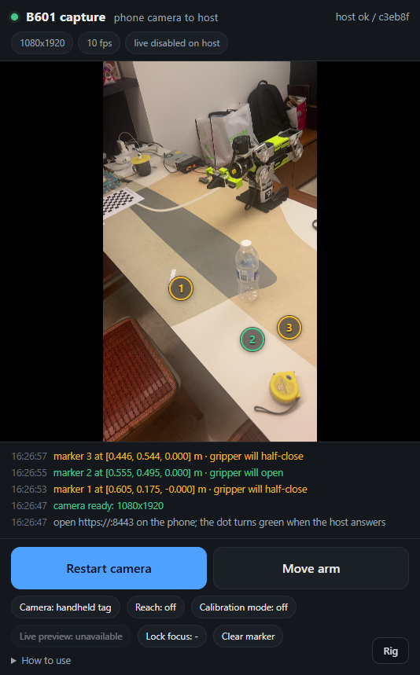
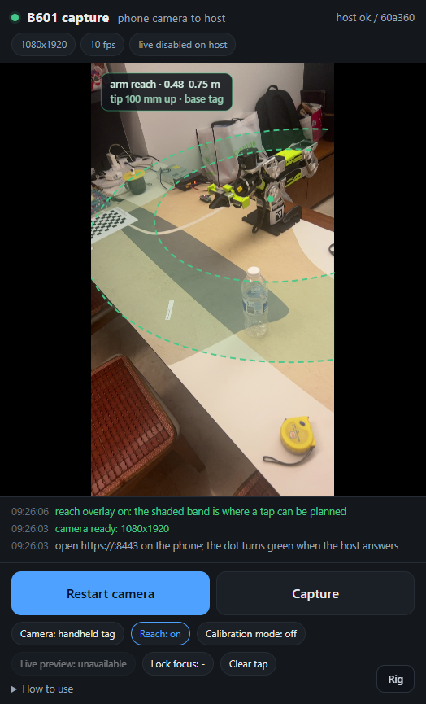

# Phone camera -> host trajectory

A phone in the browser is a camera the kitchen already owns. This turns one
still from it into a point in the arm's base frame, then into a joint trajectory
the Pi replays -- the same `rebot-joint-trajectory` file as
`plan_with_pinocchio.py`, with the same safety gates.

The design is two planes, not one video pipe:

| | preview (aiming) | capture (planning) |
|---|---|---|
| what | 640x360 - 1280x720, 15-30 fps | one full-resolution JPEG |
| how | WebRTC (WHIP) through MediaMTX | `POST /capture` |
| needs | best effort | calibration, a fitted rig (or a tag), a still arm |
| kept | no | yes, next to the trajectory |

Video is for the person holding the phone. The planner only ever sees an
immutable frame whose intrinsics, extrinsics and arm pose are all known, which
is what makes a plan reproducible and a failure debuggable.

```
phone page (tap) ─┐
                  ├─ grab the frame under the tap ─► /capture
/live page  (tap) ─┘                                      │
                                                          ▼
                                   capture server: locate_target.py
                                   calib + rig (or ArUco PnP) + table plane
                                                          │
                                                          ▼
                                   arm gateway (planner container)
                                   edge /pose ─► Pinocchio ─► out/<id>.json
                                                          │
                             [Move the arm] ──────────────┴─► POST /play ─► rebot-edge
```

The geometry and the planner are shared; the UI on top differs. The phone
collects numbered markers and **Move arm** turns them into one pass, while `/live`
keeps the single-tap plan and its two-step Move button.

## First, prove it on your machine

```bash
# in the compose stack (nothing else needed)
docker compose -f examples/host/compose.yaml --profile tools run --rm tools tests/selftest.py

# or from a venv, see "Or run it on the host directly" below
python examples/host/tests/selftest.py
```

150 checks, no phone and no arm: a synthetic camera calibrates itself, a rendered
tag recovers a known 3D point to a fraction of a millimetre, a camera pose is
recovered from eight synthetic arm poses with a 30 px mis-click in the set, a
capture round-trips through the real HTTP server, and the trajectory payload is
checked against the player's own rules. If this fails, the pipeline is wrong,
not your measurement.

The page is the one part that needs a browser. `browser_check.py` runs it in
headless Chrome: it substitutes a canvas for the camera, taps a known pixel,
captures once, and checks the stored tap and image size:

```bash
# with the capture server already running
chrome --headless=new --remote-debugging-port=9333 --ignore-certificate-errors \
    --user-data-dir=/tmp/rebot-chrome about:blank
python examples/host/tests/browser_check.py --connect 9333 \
    --url "https://127.0.0.1:8443/?token=test-token"
```

It checks the page, not the lens: focus, exposure and intrinsics are still the
phone's problem.

## Run it in containers

The whole host side is one compose file: the capture server, MediaMTX, the arm
gateway (Pinocchio, talking HTTP to `rebot-edge serve`) and a one-shot `tools`
container (certificates, calibration, tags).

```bash
cd examples/host
cp .env.example .env            # REBOT_HOST_IP, REBOT_EDGE_URL, camera mode
docker compose up -d --build
docker compose --profile tools run --rm tools app/make_cert.py --host rebot-host
docker compose restart capture
```

| service | what | published |
|---|---|---|
| `capture` | the HTTPS endpoint the phone opens; tap -> capture -> plan | `8443/tcp` |
| `mediamtx` | WebRTC relay: phone in, `/live` out | `8189/udp` |
| `planner` | the arm gateway: edge `/pose`, Pinocchio planning, optional execute | nothing |
| `tools` | `calibrate_intrinsics.py`, `calibrate_extrinsics.py`, `make_cert.py`, `selftest.py` | nothing |

Everything after that is a tap or a command:

```bash
docker compose --profile tools run --rm tools app/calibrate_intrinsics.py
docker compose --profile tools run --rm tools tests/selftest.py
```

Four things that matter:

- **The phone only ever talks to `:8443`.** MediaMTX's signaling is reached
  through the relay inside `capture_server.py`, so `8889` is not published; only
  the media port `8189/udp` is, because after the handshake the phone sends RTP
  straight to `<REBOT_HOST_IP>:8189`.
- **`REBOT_HOST_IP` must be the host's LAN address**, not the container's. It is
  the ICE candidate MediaMTX advertises, and it is what the certificate is
  issued for. A container address works for nothing but itself.
- **`captures/`, `calib/`, `tls/`, `work/` and `out/` are bind mounts**, so
  `docker compose down` does not lose them.
- **Without a certificate the stack still starts**, on plain http, and says so.
  The phone will refuse the camera until `make_cert.py` has run. That is
  deliberate: `compose up` should not crash-loop before the CA is installed.

The planner image is built from `examples/host/Dockerfile.pinocchio` (Pinocchio
has no Windows wheels) by `docker compose build`, about two minutes once. The
gateway needs `REBOT_EDGE_URL` to point at the board's `rebot-edge serve`;
without a reachable edge the stack still plans from taps but every plan fails at
the pose, which is what the panel will say.

In the commands that follow, `python examples/host/app/<script>.py` is either
the venv form or, in containers,
`docker compose --profile tools run --rm tools app/<script>.py`.

## Or run it on the host directly

The same code runs from a host venv; this is the shorter loop while editing the
page or the geometry, because it skips a rebuild.

```bash
uv pip install -r examples/host/requirements.txt
```

`opencv-contrib` is required: `cv2.aruco` is not in the plain build.
`plan_to_target.py` is not in that list; it runs in the Pinocchio container.

Download a MediaMTX binary from <https://github.com/bluenviron/mediamtx/releases>
and run it with the config next to this file:

```bash
mediamtx examples/host/deploy/mediamtx.yml
```

## TLS: the phone will not open the camera without it

`getUserMedia` only exists in a secure context, and `http://<lan-ip>` is not one.

```bash
# compose: REBOT_HOST_IP from .env becomes the certificate's IP
docker compose --profile tools run --rm tools app/make_cert.py --host rebot-host
docker compose restart capture

# host venv
python examples/host/app/make_cert.py --host rebot-host --ip 192.168.1.23
```

Install `tls/ca.pem` on the phone once:

- **iOS**: AirDrop or open the file -> Settings > General > VPN & Device
  Management > install the profile -> Settings > General > About > Certificate
  Trust Settings > enable it.
- **Android**: Settings > Security > Encryption & credentials > Install a
  certificate > CA certificate.

`docker compose up -d` already started the server with those files. From a venv
it is:

```bash
python examples/host/app/capture_server.py \
    --cert examples/host/state/tls/cert.pem \
    --key  examples/host/state/tls/key.pem \
    --token pick-something
```

Open `https://192.168.1.23:8443/?token=pick-something` on the phone. The URL
token is remembered in `localStorage` and stripped from the address bar. If the
host's IP changes, `make_cert.py --reuse --ip <new-ip>` mints a new leaf; the CA
stays installed.

## Paste the marker on the base (handheld only)

Skip this section if the camera is on a bracket: the next one replaces it, and
no marker is needed at all.

The sheet is `examples/host/docs/base-marker.pdf`: an ArUco 4x4, id 0, **4 cm**
across the black square, on a 70 x 82 mm page with a 15 mm quiet zone and a 4 cm
bar. Print it at actual size (no "fit to page") and check the bar with a ruler.

Paste it **upright on the side of the base**, not flat on the worktop: a phone
held at chest height then sees it face-on instead of at a glancing angle. Record
its centre `x, y, z` in the base frame (metres) and the heading its printed face
points to (degrees, counter-clockwise from base +x):

```
REBOT_MARKER_AT=0.14,0.0,0.06,180
REBOT_MARKER_SIZE=0.05
```

`docs/base-marker.md` has the measurement detail. A tag lying flat on the worktop
is no longer supported.

The tag supplies the extrinsics on every frame, so a handheld phone is fine.
Which means the rule that matters: **the tag must be visible in the same frame
as the target**. If the phone moves after the pose was solved, the target moves
with it.

## Fix the camera, fit the rig once, then never place a tag

A bracket turns the extrinsics from a per-frame measurement into a constant, and
a constant can be measured without printing anything: the arm is an object of
known geometry standing in the middle of the scene.

**One tap, then the arm sweeps.** Take one still, tap the tool tip in it, and the
sweep does the rest:

```bash
# 1. one still, with the pose the arm actually had
docker compose --profile tools run --rm tools app/calibrate_extrinsics.py \
    --capture-pose --camera rtsp://mediamtx:8554/phone
# 2. open the frame it names, read the tool tip's pixel, then sweep and fit
... app/calibrate_extrinsics.py --auto --camera rtsp://mediamtx:8554/phone \
    --from /app/state/captures/<id> --uv 812 455
# 3. audit it: residuals, leave-one-out, the error a tap costs
... app/calibrate_extrinsics.py --check
```

The sweep moves the arm through the eight checked poses in `sweep.py`, takes a
still at each with the joint angles attached, finds the tool tip, fits
`T_base<-cam` and the tip's offset in `gripper_end`, and either writes the rig or
refuses with the reason:

    unknowns   T_cam<-base (6) + tip offset (3)
    residuals  one detected tip per pose  (2 per pose)

Every leg is a cosine-eased joint move -- zero velocity at both ends -- capped at
`sweep.PEAK_SPEED` (0.35 rad/s, about 20 deg/s). The whole pass is about three and
a half minutes. The gateway recomputes the duration from the pose it is actually
in, so a caller can ask for a slower move but never a faster one.

The board treats a move as a round trip: when a trajectory ends, the player
ramps the arm back to the pose the move started from. So the whole sweep is **one
trajectory** -- park, pose 1, pose 2, ... pose 8 -- with a **hold** at each
(`sweep.HOLD_SECONDS`, 1.5 s), and the board walks the arm back to park once, at
the end. One `/move`, one motor enable cycle, and no return leg between poses:
about 105 s of motion instead of 190. The arm begins and ends at the same pose, by
construction, and the way back is timed by its distance (a cosine ease capped at
0.35 rad/s, at least 3 s) rather than a fixed second count, so a long return is
never rushed.

**Gravity sag is compensated in the command.** The MIT frame has no integral
term, so a loaded joint rests `tau_g / kp` away from what it was told. This arm
settles as `held = command - sag` -- a sign that comes from j2's axis, not from
intuition, and was measured rather than assumed: commanding `target - sag` moved
every pose by another |sag|. `rebot_ik.gravity_torques` -- the URDF model the
planner already uses -- predicts the sag to within about 20%, and correctly
predicts none on j1 (vertical axis: that residual is friction). So `/move` asks
for `aim()`, the fixed point of `command = target + sag`, and the arm holds the
poses the table was validated at. That matters for geometry, not for the solver:
100 mrad is 60 mm at the tool, against a 12 mm clearance margin. What the *fit*
uses is unchanged either way -- the pose the arm actually held, measured.

**The pass is recorded, not photographed.** MediaMTX already has the stream, so
it does the recording: the capture server starts and stops it through the
control API, and samples the arm's pose 15 times a second into `poses.jsonl`
alongside. Afterwards each pose is found by *time*: a **hold** is a window where
the arm actually stopped -- consecutive samples within `sweep_video.STILL_RAD`,
lasting at least 0.5 s -- and the holds are matched to the poses in sweep order,
nearest first. The frame at the middle of the matched window is saved as
`pose-N.jpg`.

The offset between the commanded pose and the held one is reported, not required
to be zero. The servo holds a gravity-loaded joint *below* its command (there is
no integral term), and the real sweep settles **31-108 mrad** low; the fit uses
the **measured** pose, so a steady offset is not an error. `MAX_OFFSET_RAD`
(150 mrad) only rejects a stop that is nowhere near the pose it should be.

That window is why the hold still exists. A frame arrives older than the moment
it is received, so a timestamp alone would pair it with the wrong pose; but
*while the arm holds*, every frame in the window shows the same pose whatever the
latency is. A pose the arm merely passed through has no window and is refused
rather than guessed.

    state/recordings/phone/2026-11-13_10-23-21-813025.mp4   MediaMTX segments
    state/captures/<id>/poses.jsonl                         pose, 15 Hz
    state/captures/<id>/pose-1.jpg .. pose-8.jpg            one per pose
    state/captures/<id>/poses.json                          how each was chosen

Recording is off by default (`record: no` on the path) and switched on per sweep,
so the disk only fills with passes someone asked for. Three things must be true:
`api: yes` in `mediamtx.yml` (it is, and the API is published on loopback only),
a `./state/recordings` volume for MediaMTX, and the camera must be that stream --
`REBOT_CAMERA=rtsp://mediamtx:8554/phone`, since a USB device or a snapshot URL
has no path to record. `REBOT_MEDIAMTX_API` and `REBOT_RECORDINGS` point at the
API and the shared directory.

Then set `REBOT_EXTRINSICS=state/calib/extrinsics-fixed.json`, restart `capture`,
and `/health` will report `"mode": "fixed"` with the rig's fingerprint. Taps no
longer look for a marker.

**Why one tap is enough.** A tap is two constraints, not a pose: it fixes the ray
back from a known 3D point, so the camera can sit anywhere on that ray, at any
distance, with any roll about it. The sweep enumerates that family coarsely --
the tap pins the *pixel*, so every candidate points its search window at the
right place -- and keeps the candidate whose eight detections agree with each
other. The measurement decides, not a guess about where the bracket was bolted.

**Two numbers to read before trusting it.**

- `predicted` is what a tap costs over the work area, in millimetres -- not a
  reprojection error. Under ~5 mm is a normal install; the synthetic fit in the
  selftest reaches 0.6 mm.
- `condition` names the direction the sweep left weakest. If it says `tz`, every
  pose was at the same distance; if `rz`, every wrist was at the same angle.

**The model becomes part of the calibration.** The tag is independent of the
arm; this is not. A joint-zero error of 5 mrad rotates the estimated camera
about the base by 5 mrad, which is 3 mm at a 0.6 m reach, and it is invisible in
the residual because the model and the image agree with each other. Zero the arm
properly before fitting, and refit after anything that changes the zeros.

### The mount can still move

The tag made stale extrinsics impossible. A bracket gives that up, so the fit
also writes a **witness**: the frame it was fitted on plus a grid of background
patches, with the arm masked out by the kinematic model. Every later capture
tracks those patches and refuses the tap when the background moved more than
`REBOT_WITNESS_MAX_PX` (default 2 px, under a millimetre at 1 m) or when the
field of view changed (focus, zoom). The drift it measured goes into
`target.json` and the trajectory's `capture` block, so a bad plan is
attributable afterwards.

That gate is the replacement for "the tag was in this frame". Turn it off by
capturing without a rig, at the cost of the old failure mode: a moved camera
biases every plan with nothing in the log to show for it.

### The same thing over the API

`POST /calibrate/extrinsics` is that pass in one call. The tap comes from
`POST /capture/pose` and a pixel:

```bash
# one still, with the pose the arm actually had
curl -sk -X POST https://127.0.0.1:8443/capture/pose -H "X-Rebot-Token: $REBOT_TOKEN"
# {"ok": true, "id": "20261113T101500Z-a1b2c3", "image_url": "/captures/.../frame.jpg"}

curl -sk -X POST https://127.0.0.1:8443/calibrate/extrinsics \
  -H "X-Rebot-Token: $REBOT_TOKEN" -H 'Content-Type: application/json' \
  -d '{"confirm": true, "capture": "20261113T101500Z-a1b2c3", "u": 812, "v": 455}'
```

`REBOT_CAMERA` names the stream (`rtsp://mediamtx:8554/phone`, an HTTP snapshot
URL, or `device:0` for a USB camera).

The panel is the same flow with the picture in it: **Capture one pose** takes a
still from `REBOT_CAMERA` and records the pose, the image appears in the card, a
tap on the tool tip marks the pixel, and **Run the sweep from this tap** starts
the arm. Nothing is typed and there is no second path.

| route | what it does |
|---|---|
| `POST /capture/pose` | one still plus `GET /pose`, written as a capture |
| `POST /calibrate/extrinsics` | `{confirm, capture, u, v}` sweeps, fits, verifies, writes |
| `GET /calibrate` | running state, progress, the last verdict, the current rig |
| `GET /reach.json` | `K`, `dist`, plane/hover, the tag placement, and `T_base_cam` for the phone's reach overlay |
| `POST /locate` | `{capture, mode}` -> the base-frame point for one marker |
| `POST /sequence` | `{targets:[...]}` -> a multi-marker trajectory from the gateway's `/plan-sequence` |

Three gates, because this moves the arm with nobody at the panel: `REBOT_EXECUTE=1`
on the host, `--allow-execute` on the edge, and `"confirm": true` in the body.
The sweep also refuses to start if the path from the current pose back to park
is not clear, and every leg is re-checked against the capsule model before the
gateway sends it.

The gateway does not need the edge to hold anything: the hold is in the
trajectory the gateway builds, and the host takes the still inside it. If the
panel reports that the arm "never stood still where it was sent", the hold was
missed -- check that the board is not slower than the plan, and that the arm is
not stuck (the message says which).

**The detector is the honest weak link.** It differences each pose against the
median of the other seven, takes the distal end of the arm silhouette near the
model's projection, and fits. On the capsule model the selftest uses, that lands
the camera to about 1 deg and 10 mm -- a bootstrap, not a rig -- so the
verification refuses it. The API says so rather than writing a bad file: `422`,
with the per-pose detections and the failed check in the body. Run it again with
the arm still and the tip clearly in view; a real gripper's jaws are a sharper
edge than a constant-radius capsule, and `"background": "<arm-free still>"`
removes the remaining ghosting from the median.

`GET /calibrate` reports whether a sweep is running and how the last one ended.
A successful POST hot-loads the rig, so the next tap uses it without a restart.

Both pages carry the same call as a panel: the **Rig** button in the bottom
right corner (or `?rig=1` on the URL) shows whether the host will move the arm,
takes the bracket's position, runs the sweep with a progress line, and renders
the verdict -- the reasons, the per-pose table, and the captures to re-click if
it refuses. It is `viewer.js`, so the phone page and `/live` behave identically.

## Calibrate once per phone camera

Take 15-20 shots of a printed checkerboard with **Calibration mode** on: tilt it,
put it in the corners, fill the frame, then pull back. Then:

```bash
python examples/host/app/state/calibrate_intrinsics.py \
    --captures examples/host/state/captures --cols 9 --rows 6 --square 0.025
```

It writes `calib/<device>.json`. The RMS gate is 1 px; drop views above 2 px
with `--drops`. A fit at 0.5 px on 12 good views beats 1.5 px on 30 sloppy ones,
and a bad `K` shows up later as a target that is "always 30 mm to the left".

Calibration is per camera, per resolution, **and per zoom**. The page reports
`zoom` when the browser exposes it; if it is not 1.00, recalibrate at that zoom
or don't zoom. `calib.load()` rescales `K` between resolutions of the same aspect
ratio and refuses to cross a crop.

## Markers, then Move arm

On the phone a tap no longer plans. It captures that exact frame, locates the
pixel in the base frame and pins a numbered marker on the preview. Up to ten;
**Clear marker** removes the last one. **Move arm** is disabled until at least
one marker is on screen. Odd markers are amber (the gripper will half-close);
even markers are green (it will open).



```
marker tap (u,v)
  -> the page grabs that exact frame                    (/capture)
  -> capture_server runs locate_target.py on it         (/locate)
  -> the marker is numbered and its base point kept
Move arm
  -> all targets become one multi-marker pass           (/sequence -> /plan-sequence)
  -> the arm visits them in order, holds at each
  -> the trajectory runs                                (/execute -> POST /play)
```

The gripper starts fully open -- it opens before the arm leaves its first pose
-- half-closes at odd-numbered markers and opens at even-numbered ones. The pass
finishes back at the pose it started from, so odd/even on screen is the whole
rule. Between markers the arm moves in joint space (checked against the table
capsule), and the tool yaw follows each marker's direction from the base, which
is the free-yaw envelope the reach band draws.

The **execution gate is unchanged**: with `REBOT_EXECUTE=0` the Move arm call
still plans and writes `out/<id>.json`, but does not move; the log says so. With
execution enabled, Move arm is the one deliberate action that moves the arm (the
two-step confirm that belongs to the single-tap panel is not part of this flow).
The edge still re-checks limits and steps.

- **One of two things supplies the extrinsics.** With `REBOT_EXTRINSICS` set, a
  fitted rig does, and nothing else has to be in frame. Without it, the tag must
  be visible in the same frame as the marker, on every marker tap.
- **Every plan is also a file.** `out/<id>.json` is a normal trajectory, so
  `rebot-edge --check` works on it without the browser.
- **The workstation's `/live` page still taps once** and plans one point with
  `viewer.js`; that panel is unchanged. The phone's `viewer.js` instance is
  disabled and kept only for the **Rig** button.

If you would rather drive it from a shell, the same three steps exist as
commands:

```bash
# 1. capture -> base-frame point, with a picture of what it believed
docker compose --profile tools run --rm tools app/locate_target.py \
    --capture /app/state/captures/<id> --calib /app/state/calib/<device>.json \
    --tag-size 0.080 --tag-x 0.35 --tag-y -0.20 --tag-yaw 15 \
    --annotate /app/state/captures/<id>/annotated.jpg

# 2. point -> trajectory, through the same code the gateway runs
docker compose run --rm --entrypoint python planner /app/app/plan_to_target.py \
    --joints /app/state/work/current.json \
    --target /app/state/captures/<id>/target.json \
    --out /app/state/out/seq.json --tool-axis z-

# 3. the gate as always
./rebot-edge seq.json --check
./rebot-edge seq.json --execute --track
```

### Which axis points down

`--tool-axis` holds the dumped pose's orientation by default, which is the one
the arm is known to reach from. A top-down grasp needs the local axis that points
out of the gripper. Ask the model instead of guessing:

```bash
docker compose run --rm --entrypoint python planner /app/app/plan_to_target.py \
    --joints /app/state/work/current.json --inspect
```

It prints each local axis of `gripper_end` in the base frame and its angle from
straight down; pick the one near 0 deg. `--yaw` then spins the gripper about the
vertical. (On the reference arm at the parked pose, `z-` is 0 deg and everything
else is 90 or 180.) Put both in `.env` as `REBOT_TOOL_AXIS` / `REBOT_YAW`.

The plan starts with a joint-space "unpark": 8 deg on j3 by default, the same
peel `plan_with_pinocchio.py` uses, because the parked pose rests on the j2/j3
lower stops and a Cartesian IK that begins exactly on a stop often refuses to
move. `--unpark-j3 0` disables it; the leg is mirrored at the end of the plan.

## The reach overlay on the phone

The **Reach** chip paints a translucent band over the preview: the part of the
table a tap can actually be planned in. Everything except a few numbers is done
in the page -- `web/reach.js` holds the same six-joint chain as `rebot_ik.py`,
runs a damped-least-squares IK to find the inner and outer radial limits of a
tool-down pose, and projects the resulting annulus through the pinhole camera.
The host adds one read-only route, `GET /reach.json`, which returns only what the
browser cannot know: `K`, `dist`, `image_size`, `plane_z`, `hover_m`, `tip_m`,
the tag's placement, and -- for a fixed camera -- `T_base_cam`.



The screenshot above is a real capture with the pose solved in the page from the
base tag: the inner edge clears the arm because it cannot fold the tool down any
closer, and the outer edge is where the planner's `--max-reach` stops.

Three numbers shape the band:

- **Hover height.** The planner aims the flange `hover_m + tip_m` above a tapped
  point, so the band is the set of points whose *tip* can sit `hover_m` above the
  table. `--plane-z` moves it up or down with the worktop.
- **The inner edge is real.** At the table the wrist cannot fold the tool down
  closer than about 0.60 m from the base axis (0.48 m at the default 100 mm
  hover). A tap inside it is refused by IK, not by an arbitrary radius gate.
- **The outer edge is the planner's gate.** The kinematic reach is a few
  centimetres wider than `--max-reach` (0.75 m); the overlay clips to the gate so
  it never promises a plan the gateway will reject. Joint 1 stops at +-2.8 rad,
  which is the 40 deg wedge missing behind the base.

**The camera pose is measured in the page too.** With a fixed rig it is a
constant. Without one, `web/aruco.js` finds the printed 4x4_50 tag on the base in
the live video and solves `T_base_cam` itself on every few frames:

- adaptive threshold (integral image) -> connected black components -> convex
  hull -> the four sharpest corners;
- a 1 px erosion breaks the thin bridge where the tag's border touches the black
  base, so the tag becomes an island even at a grazing angle;
- the six-by-six modules are sampled through a homography and matched against the
  known id 0 pattern under all four rotations;
- the four corners become a pose through a homography, refined against the fitted
  lens distortion. A planar square has two pose solutions; the phone being above
  the worktop rejects the mirror twin (which puts the camera below the table).
  Corners are fitted to subpixel edge gradients at full resolution.

No frame leaves the phone and there is no per-frame server call. On a desktop
Chrome a detection takes about 25-80 ms at 810x1440, and the page runs it about
three times a second, so the band follows a moving phone without a tap. Against
the twelve stored bench captures, ten recovered to **17-43 mm and 0.7-2.7 deg**;
the two misses are marginal views where the tag is small or partly merged with
the base. A missed frame keeps the last pose for **3 s**; after that the band is
cleared, and it reappears when the tag is found again. A fixed rig never needs
the tag, so it never clears.

The browser detector knows **4x4_50, id 0** only -- what `base-marker.pdf`
prints. A different tag needs the fixed rig. A fitted rig is also more accurate
than a 40 mm tag seen at an angle, so it remains the better choice when the
camera can be bolted down.

The projection is a `T_base<-cam` transform followed by the same Brown-Conrady
model as `cv2.projectPoints`, so the band lands on the table rather than merely
near it. The canvas is sized to the letterboxed video, not to the stage, so the
band stays registered in portrait and landscape.

## What it can and cannot do

- **In-plane accuracy** is a few millimetres at 0.6-1.5 m with a good `K`; the
  synthetic test measures 0.15 mm, the real phone will be worse.
- **A fitted rig has its own error, reported rather than assumed.** The sweep
  prints what a click costs over the work area; below ~5 mm is normal, and it is
  dominated by the arm model, not by the clicks. The tag path has no such
  dependence on the arm -- that independence is what it costs to print one.
- **Out of plane** comes from the table-plane assumption (`--plane-z`). It is
  exact for things lying on the worktop and wrong for anything with height: a
  40 mm object is 40 mm off. Approach vertically and let the existing 6 cm close
  pose absorb it, or add a second view later.
- **Grazing views are the failure mode.** A tap whose ray hits the table at 20
  deg turns every pixel into centimetres; `--max-grazing` (80 deg) refuses the
  worst, but aim further down.
- **The phone is not a metrology camera.** Your kitchen manuals say the same
  about the fixed RGB-D; use this for "wipe here", "pick that", not for
  sub-millimetre placement.
- **IK is accepted by the pose it reached**, not by the solver's success flag: a
  single tap keeps a result within 2 mm and 0.5 deg (`--ik-pos-tol`), and a
  marker sequence allows 10 mm because a marker can sit closer to the reach
  boundary; both are well inside the arm's own 23 mm repeatability. A miss
  beyond that is refused with the distance it got to.
- **Nothing here is a safety function.** The arm still only moves on
  `--execute`, after `--check`, with the limits re-verified on the edge. The
  gateway's own gate (`REBOT_EXECUTE=1`), the `/live` two-step button, and the
  phone's deliberate **Move arm** are there to make an accidental tap harmless,
  not to make the arm safe.
- **The frame is the one you saw**, decoded in the browser, not a fresh one from
  the server: a tap and its pixels cannot drift apart. The cost is that a tap
  taken while the phone is moving is a few hundred milliseconds old.

## Troubleshooting

| symptom | cause |
|---|---|
| page loads, camera button does nothing | not https, or the CA is not trusted on the phone |
| `getUserMedia` NotAllowedError on iOS | permission denied; Safari > Website Settings > Camera |
| capture works, `locate_target.py` says "no ArUco marker" | tag out of frame, or too small/blurred at that distance |
| "tag reprojection 4 px is above --max-reproj" | phone moved during the exposure, or `--tag-size` is the sheet size, not the black square |
| live preview never connects | phone and host on different VLANs / AP isolation; UDP 8189 blocked |
| "aspect ratio changed" | calibrated at 4:3, captured 16:9; recalibrate at the capture size |
| live preview works, `/live` does not | MediaMTX up but the path has no publisher yet |
| IK failed at the target | target outside the arm's reach, or too close to the base; loosen `--max-reach`, move the phone view |
| compose: page loads but the camera is blocked | no certificate yet (`make_cert.py`), or the CA is not installed on the phone |
| compose: live preview never connects, `/health` is fine | `REBOT_HOST_IP` is empty or is the container's address; set the host's LAN IP in `.env` and restart |
| compose: `pull access denied for rebot-pino` | the planner image is not built; `docker compose build planner` |
| tap: "no ArUco marker in the frame" | the tag is outside the frame the tap came from; aim so the tag and the object are both in view |
| tap: "the camera moved since the extrinsics were fitted" | the witness caught a knock: refit, or put the mount back |
| tap: "cannot verify the camera mount: only N of 64 witness patches" | the view changed too much to compare -- lens covered, lights off, or the camera moved far |
| tap: "this rig was fitted at 4032x3024 but the camera is calibrated at ..." | the capture size changed (a different page mode or phone); refit at that size |
| "no extrinsics at ..." on start-up | `REBOT_EXTRINSICS` points at a file that is not there; run `--auto` or unset it |
| the panel: "not reachable: cannot reach the arm gateway" | the capture server can not open a socket to `REBOT_PLANNER`; in compose it is `http://planner:8000` -- check `docker compose ps planner` |
| the panel: "the gateway refused /pose" | the gateway answered, so the route or the method is wrong; `/pose` is a GET, `/plan`, `/execute`, `/move` are POSTs |
| "pose N never stood still where it was sent" | the arm never reached the pose inside the hold: `/play` returned 200, so check `can_up`, the e-stop and the motor enables first |
| "the board's CAN channel is down" | the interface exists but is not up; `ip link set can0 up type can bitrate 1000000` on the board |
| `--auto`: "the sweep leaves ... free to N mm" | the poses were too similar: add height and wrist variation (edit `sweep.py`) |
| `--auto`: "the poses are degenerate (rank ...)" | every pose in one plane; move the arm in 3D |
| `--auto`: "a capture has no pose" | the still was not taken with `/capture/pose` (or `--capture-pose`) |
| tap: "arm gateway unreachable" | the `planner` service is down; `docker compose ps` |
| tap: "cannot reach the edge" | the board is not running `rebot-edge serve`, or `REBOT_EDGE_URL` is wrong |
| tap: the edge answers 401 | `REBOT_EDGE_TOKEN` does not match `--token` on the board |
| tap: the edge answers 503 on /pose | `can0` is down on the board; see the edge README |
| `/live` tap: no "Move the arm" button | `REBOT_EXECUTE=0`; set it to 1 and `docker compose up -d` |

## Files

| file | job |
|---|---|
| `compose.yaml` | the host stack: `capture`, `mediamtx`, `tools`, `planner` |
| `Dockerfile` | the capture server and every one-shot tool, in one image |
| `.env.example` | `REBOT_HOST_IP`, `REBOT_TOKEN`, `REBOT_PORT`, `REBOT_EXTRINSICS` |
| `healthcheck.py` | compose healthcheck for the capture service |
| `phone.html` | the phone page: numbered markers, Move arm, reach overlay, calibration, WHIP |
| `live.html` | workstation viewer: WHEP playback and single-tap planning |
| `viewer.js` | the tap -> capture -> plan -> execute panel used by `/live` and the phone's Rig button |
| `markers.js` | numbered markers on the phone: capture, locate, pin, clear, up to 10 |
| `reach.js` | the phone's reachable-band canvas overlay (IK + projection, in the page) |
| `aruco.js` | browser-side 4x4_50 detection and pose for the live handheld overlay |
| `capture_server.py` | TLS endpoint, `/capture`, `/locate`, `/plan`, `/sequence`, `/execute`, calibration, WHIP/WHEP |
| `planner_server.py` | the arm gateway: edge `/pose`, `/plan`, `/plan-sequence`, gated execution |
| `make_cert.py` | local CA + leaf certificate for the phone |
| `base_marker.py` | the printable marker sheet and its PnP (see `base-marker.md`) |
| `calibrate_intrinsics.py` | checkerboard fit -> `calib/<device>.json` |
| `calibrate_extrinsics.py` | tool-tip sweep -> `calib/extrinsics-<mount>.json` + witness |
| `extrinsics.py` | the rig: DLT + Levenberg-Marquardt, covariance, predicted error |
| `witness.py` | did the camera move? background patches, arm masked out |
| `sweep.py` | the fixed eight-pose sequence, and the check that keeps it clear of the table |
| `auto_calibrate.py` | drives the sweep, grabs the stills, finds the tip, verifies |
| `camera.py` | where an automatic still comes from: RTSP, HTTP snapshot, device |
| `locate_target.py` | capture -> `target.json` (rig or PnP, + table plane), annotated JPEG |
| `plan_to_target.py` | the planner: target(s) + pose -> trajectory JSON, including the marker sequence |
| `traj.py` | payload assembly + the player's schema checks, no Pinocchio |
| `selftest.py` | offline proof of all of the above |
| `browser_check.py` | drives the page in headless Chrome: tap, capture, check the file |
| `mediamtx.yml` | minimal WHIP/WHEP/RTSP config |

`captures/`, `calib/`, `tls/`, `out/` and `work/` are local state; only the code
is committed.
