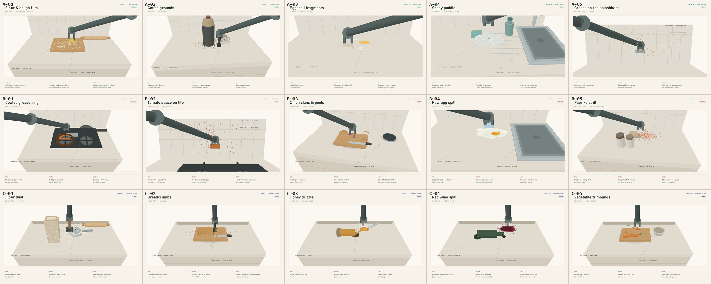
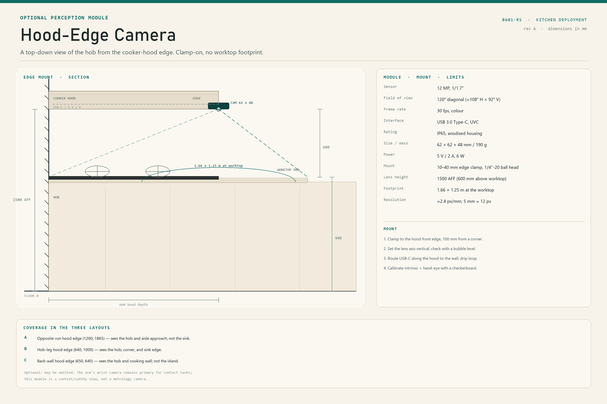
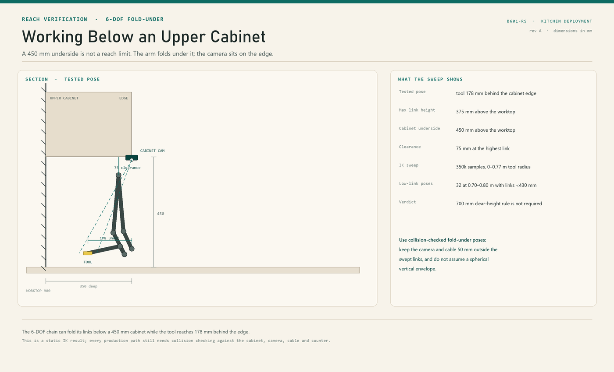

# Kitchen Deployment Manuals — reBot B601-RS

Three ways to put a **fixed-base 6+1 DOF arm** to work cleaning up after cooking in a
home kitchen. Each manual covers one kitchen topology, the placement of the arm
relative to the cooking utensils, and five mess types the arm can actually clear
within its operating limits.

> **Status.** These are deployment concepts and field manuals, not a certified
> product. The arm is not a certified collaborative robot, has no published IP
> rating, and must be supervised. Every dimension is in millimetres unless stated
> otherwise. The mess illustrations are stylised; the size windows and limits in
> the tables are the dimensional reference.

## The three layouts

| | **A — End-of-Run Sink Station** | **B — Corner Bay** | **C — Overhead Island Boom** |
|---|---|---|---|
| Kitchen | Single-wall galley | L-shaped corner | Open-plan island |
| Mount | Counter base, end of run | Counter base, dead corner | Ceiling / soffit, inverted |
| Covers | Sink, drainboard, prep tail | Sink leg + near hob burners | Central prep disc only |
| Cooktop | Opposite run, 1.45 m away | Adjacent leg, cold-clean only | Back wall, 2.2 m away |
| Optional cameras | Hood: hob + aisle. Cabinet: arm/sink | Hood: hob + corner. Cabinet: arm/corner | Hood: hob. Soffit: arm disc |
| Best for | Wet cleanup after cooking | Widest task mix, dead-space reuse | Zero worktop footprint, downward cleaning |
| Main limit | Only the wet end | Heat interlock is mandatory | Payload derated when inverted |
| Manual | [Layout A](layout-a-sink-station.md) | [Layout B](layout-b-corner-bay.md) | [Layout C](layout-c-overhead-island.md) |

*The 15 mess types at a glance: one row per layout. Each card is a close-up with
the tool, the motion, and the limiting condition; the full-size versions are in
the layout manuals.*

## The 15 messes

| Layout | 01 | 02 | 03 | 04 | 05 |
|---|---|---|---|---|---|
| **A** | Flour & dough film | Coffee grounds | Eggshell fragments | Soapy puddle | Grease on the splashback |
| **B** | Cooled grease ring | Tomato sauce on tile | Onion skins & peels | Raw egg spill | Paprika spill |
| **C** | Flour dust | Breadcrumbs | Honey drizzle | Red wine spill | Vegetable trimmings |

## Shared operating envelope

These numbers are used by all three manuals. They come from Seeed's published
specification and from measurements in this repository.

| Parameter | Value | Consequence for deployment |
|---|---|---|
| Degrees of freedom | 6 + 1 (gripper on motor 7) | 6-axis positioning, parallel-jaw grasp |
| Reach | **754.7 mm** | A 600 mm **working radius** is used for task assignment; 600–755 mm is a reserve band for light, slow work only |
| Rated / maximum payload | **2.5 kg / 5 kg** | Tool + residue must stay below 0.5 kg; no lifting pans or appliances |
| Repeatability | **0.1 mm** | Enough for pick-and-place of 5–15 mm fragments, not for force-controlled scrubbing |
| Arm mass | 4.68 kg + 0.15 kg fingers | Through-bolt the base; a clamp alone is not enough at full reach |
| Base joint range | ±160° | 320° usable sector; a **40° dead wedge** faces the wall |
| Wrist | Non-spherical, 104 mm / 60 mm offsets | Cannot point straight into tight corners; needs 40 mm clearance |
| Gripper | 0–5 rad, ≈120 mm stroke | Grabs tools and food fragments; cannot span a 300 mm board or a toaster |
| Power | 48 V DC, 12.5 A | Dedicated PSU, GFCI, cable strain relief |
| Control | Host-planned, 30 Hz replay | Cleaning paths are planned offline; contact force is capped by torque limits |
| Compliance | ~20 mm shortfall on a 10 cm lift | Contact tasks need compliant tools and a 5 mm stand-off, not hard scrubbing |

### Reach, honestly

The arm can *touch* a 755 mm radius, but it is fully stretched there and the wrist
compliance is worst. The manuals therefore assign work inside **600 mm**, keep
600–755 mm as a **reserve band**, and put everything beyond 755 mm out of scope.
Tool-down cleaning reaches the worktop across the full disc; vertical wiping
reaches roughly **600 mm above the counter**.

### What the arm is not

- Not waterproof and not submersible; no IP rating is published.
- No dedicated force/torque sensor; contact force is inferred from motor current.
- No suction, no sprayer, no scrubbing at high pressure.
- Not a certified collaborative robot; presence sensing and a supervised mode are required.
- It cannot open the oven, climb, clean the floor, clean inside the sink basin,
  handle knives, or sterilise a biohazard by itself.

## Optional cameras

Each layout can take one **12 MP, 120° camera module** in either of two places.
Use one, or both only if the host has two camera ports.

| Option | Mount | Lens height | View | Best for |
|---|---|---|---|---|
| **Hood edge** | front edge of the cooker hood | 1500 AFF | 1.66 × 1.25 m, straight down | Hob / cooking zone |
| **Under-cabinet** | bottom edge of a 300 × 350 camera cabinet over the base (soffit in C) | 1350 AFF (1450 in C) | ≈1.2 × 0.9 m, oblique (straight down in C) | Arm motion |

| | A | B | C |
|---|---|---|---|
| Hood camera | (1200, 1865) | (640, 1000) | (650, 640) |
| Under-cabinet camera | (1550, 350) | (430, 350) | (2250, 2200) soffit |
| Cabinet camera sees | Sink, base, arm | Corner, base, arm | Arm and island disc |

The hood camera is the cooking-zone view. The under-cabinet camera is the
arm-motion view: it sits on a 300 × 350 mm camera cabinet over the base at a
450 mm underside. A tested 6-DOF fold-under pose puts the tool 178 mm behind the
edge with a 375 mm highest link — 75 mm below the cabinet. The old 700 mm
clear-height rule is not a kinematic limit; use collision-checked fold-under
paths. In Layout C there are no wall upper cabinets near the island, so the
alternative uses the **bottom edge of the overhead cabinet/soffit** instead.
Both are context/safety views, not metrology cameras or safety-rated stops; the
wrist and ceiling cameras remain primary.

The module uses a 10–40 mm edge clamp and a 1/4"-20 ball head, routes USB-C along
the hood or through the cabinet, and processes locally with an active LED; no cloud
by default.

## The tool set

The gripper picks a standard 20 mm tool handle from the dock. All tools are under
300 g; the vacuum nozzle is supported by a ceiling boom so the hose does not load
the wrist.

| ID | Tool | Used for |
|---|---|---|
| T1 | Soft brush, 60 mm | Dry flour, crumbs, dust |
| T2 | Cellulose sponge | Damp wiping, blotting |
| T3 | Microfibre cloth | Final wipe, grease, vertical tile |
| T4 | Silicone scraper | Cooled grease, dried sauce |
| T5 | Crevice vacuum nozzle, 12 mm | Grounds, crumbs, fragments |
| T6 | Disposable pad holder | Soapy water, raw egg, wine |
| T7 | Detail brush, 15 mm | Grout lines, board grooves |
| T8 | Squeegee, 100 mm | Splashback, glass-top hob |

## Safety baseline

These apply in every layout:

1. **Heat lockout.** No entry into a hob zone until the surface is below 40 °C,
   the gas is off, and the burner is locked out. A 300 mm exclusion ring is drawn
   around every hob.
2. **Water and power.** GFCI on the 48 V supply, drip loops, no spray, no tool
   saturated enough to drip. The arm wipes; it does not rinse.
3. **Presence.** A 300 mm keep-clear around the base and a supervised mode. Stop
   on presence inside the working disc.
4. **Force.** Contact force capped at 5 N for wiping and 3 N on glass; torque
   limits are set in the trajectory, not left to the planner's defaults.
5. **Tools.** Tool ejection and drop detection before every cycle; no tool tip
   above 300 g.
6. **Food safety.** Colour-coded cloths, disposable pads for raw animal residue,
   disinfectant after, and a human verification step for biohazards.

## How to read the drawings

Each layout sheet has a **plan** at a stated scale with a 1 m scale bar, a
**schematic section**, and deployment notes. The plan shows the base, the 600 mm
working radius, the 755 mm maximum, the 40° dead wedge, the tool dock, and the
heat keep-out. It also shows the optional cameras: a teal module at the hood edge
and a purple module at the bottom edge of the upper cabinets (or the island soffit
in C), each with a dashed view rectangle. The mess cards are close-ups: the arm
enters from the side that matches the layout, the tool is the one named in the
footer, and the annotations give the size window and the limiting condition.

## Files

| File | Contents |
|---|---|
| [layout-a-sink-station.md](layout-a-sink-station.md) | Galley wet-end station, 5 messes |
| [layout-b-corner-bay.md](layout-b-corner-bay.md) | L-shaped corner bay, 5 messes |
| [layout-c-overhead-island.md](layout-c-overhead-island.md) | Inverted island boom, 5 messes |
| `assets/layout-a-plan.png` | Layout A plan + section |
| `assets/layout-b-plan.png` | Layout B plan + section |
| `assets/layout-c-plan.png` | Layout C plan + section |
| `assets/hood-camera-detail.png` | Optional hood-edge camera mount and coverage |
| `assets/under-cabinet-reach.png` | Verified 6-DOF fold-under pose below a 450 mm cabinet |
| `assets/layout-{a,b,c}-mess-{01..05}.png` | 15 mess illustrations |

## Sources

- Seeed Studio, reBot Arm B601-RS product and course pages:
  <https://wiki.seeedstudio.com/robotics/rebot_physical_ai_course_chapter_2/>
- Payload, repeatability, reach and power: Seeed's B601-RS specification table.
- Chain, joint limits, gripper stroke, compliance and trajectory measurements:
  this repository, [`examples/host/rebot_ik.py`](../examples/host/rebot_ik.py),
  [`examples/README.md`](../examples/README.md) and
  [`en/references/demo-validation-pi-zero.md`](../en/references/demo-validation-pi-zero.md).
- Working-envelope sampling: `manuals/_build/workspace_probe.py` and
  `manuals/_build/reach_bands.py` in this repository.

