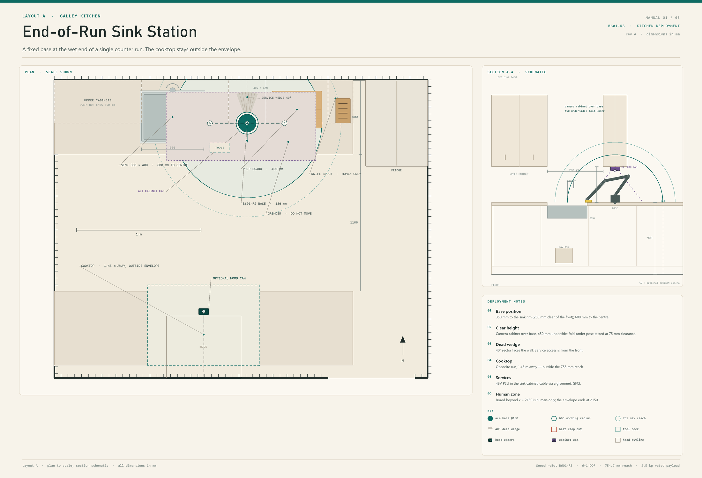
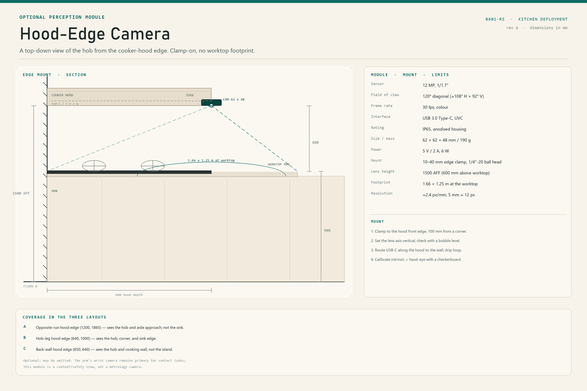
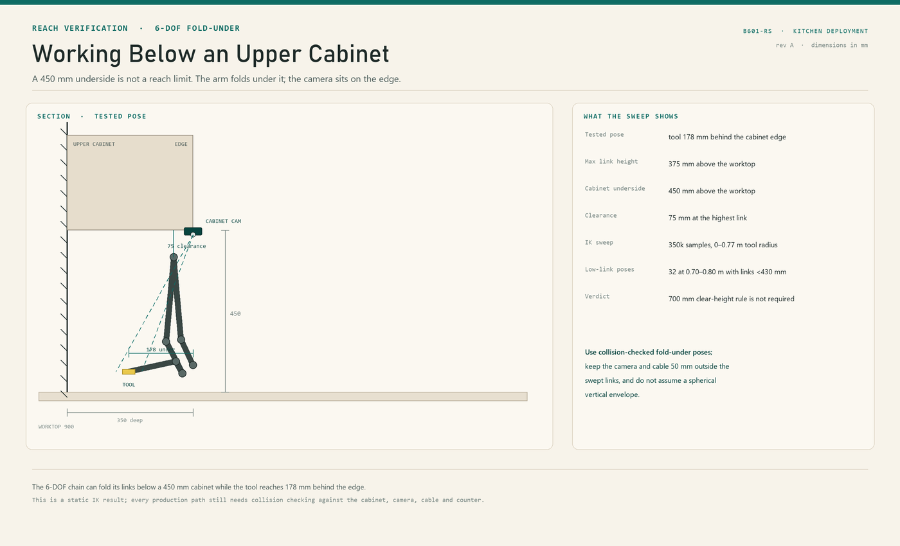
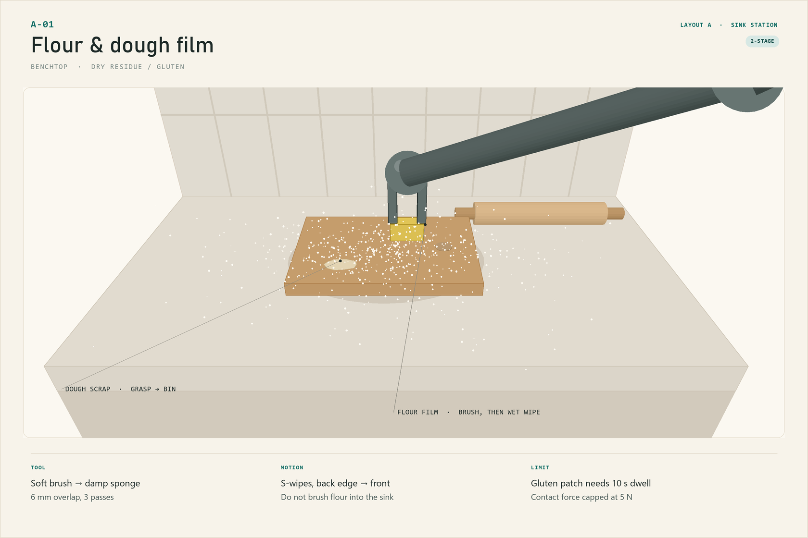
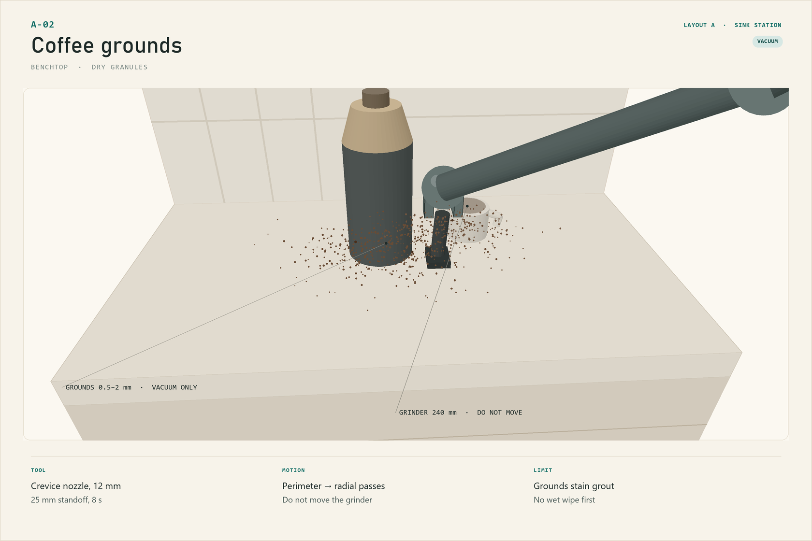
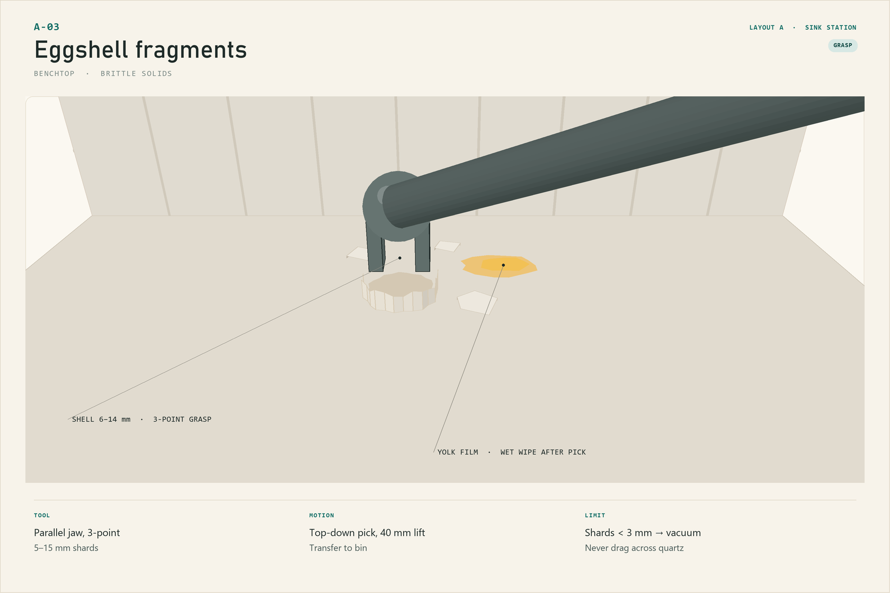
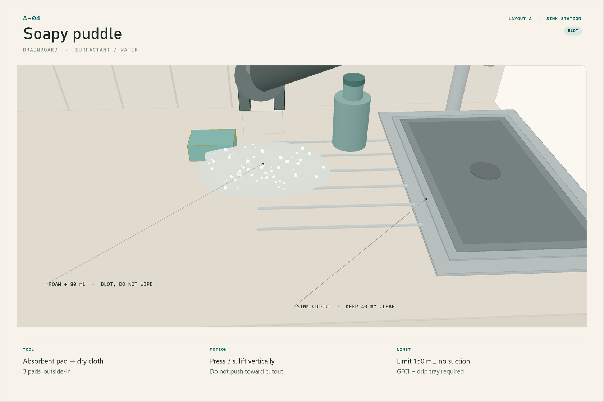
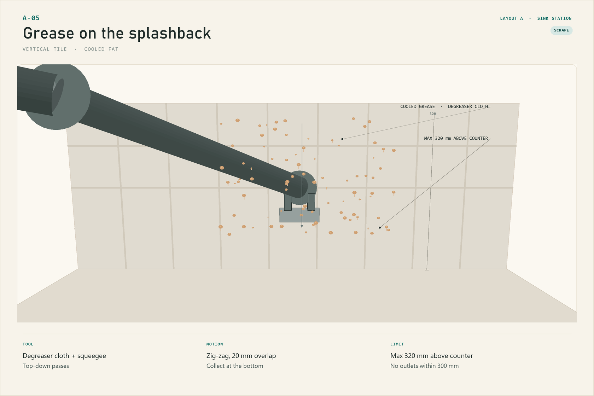

# Layout A — End-of-Run Sink Station

> **Galley kitchen · fixed counter base · wet-zone custodian**
> Manual 01 of 03 · revision A · all dimensions in mm

The arm owns the **wet end** of a single counter run: sink, drainboard, and the
prep tail beside it. The cooktop is on the opposite run, 1.45 m away and outside
the reach. This is the lowest-risk way to deploy the arm in an existing kitchen:
one bolted base, one 250 mm bay, and a shortened upper run — no appliance
replacement and no re-plumbing.

*Plan at scale with a 1 m scale bar; section is schematic. The shaded disc is the
600 mm working radius, the dashed ring is the 755 mm maximum, and the hatched
wedge is the 40° dead sector that faces the wall.*

## 1. At a glance

| | |
|---|---|
| Kitchen | Single-wall galley, 3000 × 2400 room |
| Counter run | 2400 × 600, main sink at 700–1200 |
| Arm base | (1550, 350) on a 250 mm bay at the end of the run |
| Working radius | 600 mm (solid), 755 mm reserve (dashed) |
| Covers | Sink deck, drainboard, prep board, grinder, tool dock |
| Does not cover | Cooktop (1.45 m), knife block (738 mm, reserve band), fridge |
| Best for | Post-cook wet cleanup, flour/bread mess, sink-side spills |
| Mount | Counter base, 4 × M6 through-bolts + 6 mm steel backer |
| Payload margin | Tool 0.15–0.3 kg; residue <0.2 kg; well under 2.5 kg rated |

## 2. The idea

A galley kitchen is a line of work, and the dirtiest part of the line after
cooking is the sink end: flour on the board, grounds around the grinder, shells
on the counter, soapy water on the drainboard, and grease on the splashback. That
is a cluster of flat and vertical surfaces within **600 mm** of one point. Put the
base there and the arm can do the whole post-cook cleanup without ever entering
the heat zone.

The layout deliberately gives up the middle of the counter. The arm is not a
second pair of hands for cooking; it is a slow, repeatable custodian that works
after the cook has left the zone. Its 600 mm disc covers the sink's near half and
the board's near two-thirds. The far end of the board, the knife block, and the
cooktop remain human-only.

Three design moves make the layout work:

1. **The base sits on a 250 mm bay between the sink and the board.** The arm's
   foot is 180 mm, leaving 35 mm either side for the cable and finger clearance.
2. **The main upper run stops 850 mm from the base; a 300 × 350 camera cabinet
   sits over the base at a 450 mm underside.** The arm is not excluded from
   under-cabinet work: it folds below the cabinet (tested highest link 375 mm),
   and the collision check is run on the actual path. The main run still ends
   early for lighting and tool clearance.
3. **The cooktop is across the aisle.** The arm cannot reach it even at 755 mm,
   and the 1100 mm aisle keeps heat, steam, and splatter out of the arm's zone.

## 3. Envelope check

| Constraint | This layout | Verdict |
|---|---|---|
| Reach to sink centre | 600 mm | At the working limit; work the near half and drainboard |
| Reach to sink rim | 350 mm (260 mm clear from the foot edge) | Comfortable; full wrist articulation |
| Reach to board centre | 400 mm | Comfortable |
| Reach to grinder | 362 mm | Comfortable |
| Reach to knife block | 738 mm | Inside 755 mm maximum, outside 600 mm working — human only |
| Reach to cooktop | 1450 mm | Outside 755 mm — human only |
| Vertical reach, splashback | 320 mm above counter | Inside the ~600 mm vertical envelope |
| Payload, tool + residue | <0.5 kg | 20 % of rated payload |
| Clear height above counter | Collision-free pose; 450 mm camera cabinet workable | 1500 mm to ceiling; tested 75 mm link clearance |
| Upper cabinet over base | 300 × 350 camera cabinet, 450 mm underside | Pass with fold-under path |
| Base joint sector | 320° usable, 40° dead into wall | Pass |
| Water at base | 350 mm to the sink rim, 260 mm clear from the foot | Pass with GFCI |

> **The 600 mm number is a design rule, not a hardware limit.** The arm can reach
> 755 mm, but near full extension the wrist is least stiff and the tool position
> is hardest to predict. The 600 mm disc keeps a 155 mm reserve for approach,
> tool clearance, and the ~20 mm compliance shortfall measured on lifts.

## 4. Placement

### 4.1 The base

- Position **(1550, 350)** in plan coordinates, measured from the left wall and
  the back wall.
- Footprint **Ø180 mm**; the bay is 250 mm wide, from x = 1425 to 1675.
- Base plate **200 × 200 × 6 mm steel**, four **M6 × 60** through-bolts into a
  20 mm counter with a steel backer below. A clamp is not sufficient at 600 mm:
  the static moment with a 0.5 kg tool at full reach is already ~10 Nm, and the
  arm's own 4.68 kg adds to it during acceleration.
- The **40° dead wedge faces the wall** (toward −y). The joint-1 range is ±160°,
  so the usable sector is 320°. Keep the wedge clear for the cable and for
  service access to the base.
- The base centre is **350 mm from the sink rim** (260 mm clear from the foot
  edge) and **600 mm from the sink centre**. The sink is 500 × 400; the arm works
  the near rim, the drainboard, and the right-hand deck rather than the basin
  centre.

### 4.2 Clearances

| Item | Requirement | Provided |
|---|---|---|
| Clear height above counter | collision-free pose | 450 mm camera cabinet; 75 mm tested link clearance |
| Upper cabinet distance | no fixed 700 mm rule | main run 850 mm; camera cabinet over the base |
| Rear clearance | 100 mm for the elbow and cable | 150 mm |
| Front clearance | 300 mm keep-clear | 1100 mm aisle |
| Tool dock | within 300 mm | 295 mm (x = 1250–1410, front edge) |
| Bin / compost | within 400 mm | 350 mm (sink cabinet pull-out, right side) |
| Splashback access | ≤600 mm horizontal | 430–560 mm at the sink return |

### 4.3 Services

- **48 V PSU** (600 W, 12.5 A) in the sink cabinet, on a bracket 100 mm above the
  cabinet floor, away from the trap and any leak path.
- **GFCI** upstream; a **drip loop** at the cable entry; a **grommet** at the
  counter, 60 mm behind the base.
- **CAN/USB** to the host on the wall side, strain-relieved at the base.
- **E-stop** at the end of the run, reachable from the aisle without stepping
  into the arm's disc.
- **Hob interlock** is not required for reach (the cooktop is 1.45 m away) but is
  still fitted: the arm must not start while any burner is on.

### 4.4 Optional hood camera

A 12 MP, 120° module clamps to the front edge of the hood over the opposite
cooktop at **(1200, 1865)**, lens at **1500 AFF**. It looks straight down; the
dashed rectangle in the plan is its useful view. It covers the **hob and the aisle
approach**, not the sink or prep board across the aisle. Treat it as a
safety/context view: the fixed 1.9 m camera and the arm's wrist camera remain
primary for contact tasks.

| Item | Value |
|---|---|
| Module | 12 MP, 1/1.7", 120° diagonal, 30 fps, USB 3.0 UVC, IP65 |
| Size / mass | 62 × 62 × 48 mm / 190 g |
| Mount | 10–40 mm edge clamp, 1/4"-20 ball head, lens axis vertical |
| View at worktop | 1.66 × 1.25 m, ≈2.4 px/mm (5 mm ≈ 12 px) |
| Cable | USB-C along the hood to the wall; 5 V 2 A; drip loop; strain relief |
| Calibration | intrinsic + hand-eye to the base; checkerboard on the hob |
| Privacy | local UVC only; LED when active; no cloud by default |

The camera is optional; omit it and the arm still runs from the fixed camera.
Mount it at least 600 mm above the worktop and 100 mm from the hood corner, and
keep the lens out of the direct burner plume.

### 4.5 Alternative: under-cabinet camera

A 300 × 350 mm camera cabinet sits **over the base at (1550, 350)**, underside
**450 mm** above the worktop. The camera is on its bottom edge, lens **1350 AFF**,
pitched **30° down**; the dashed purple rectangle in the plan (900–2100 × 100–650)
is its view of the sink, base, and arm. Section A–A marks the module **C2** and shows its sight lines.

A fixed 700 mm clear-height rule is **not a kinematic limit**.
A tested 6-DOF pose puts the tool **178 mm behind the cabinet edge** with the
highest link at **375 mm** — 75 mm below the 450 mm underside. A 350k-sample IK
sweep found fold-under poses across the full 0–0.77 m tool radius, including 32
poses at 0.70–0.80 m with all links below 430 mm. What matters is a
collision-checked fold-under path, not a spherical vertical envelope.

| Item | Value |
|---|---|
| Mount | bottom edge of the 300 × 350 camera cabinet; 10–40 mm clamp + 30° wedge |
| Lens height | 1350 AFF (450 mm above worktop) |
| View at worktop | ≈1.2 × 0.9 m, centred on the sink/base |
| Tested clearance | 75 mm at the highest link; 178 mm reach under the cabinet |
| Cable | USB-C through the cabinet; drip loop; strain relief |
| Trade-off | oblique/lower view, door vibration; no heat or steam |

Keep the camera and cable **50 mm outside the swept links**; the arm can work
below the cabinet, but the bracket must not sit in the path of the wrist or
forearm. Choose this for arm supervision; choose the hood camera for hob
monitoring. Do not fit both unless the host has two camera ports.

## 5. Coverage map

| Zone | Distance from base | Task | Tool |
|---|---|---|---|
| Sink near rim / right deck | 260–400 mm | Pick shells, blot, wipe | T2, T3, jaw |
| Drainboard | 150–350 mm | Foam and water | T6, T3 |
| Splashback return right of sink | 430–560 mm, 0–350 mm up | Grease wipe | T3, T8 |
| Prep board, near two-thirds | 400–600 mm | Flour, dough, crumbs | T1, T2 |
| Counter around grinder | 300–450 mm | Grounds | T5 |
| Tool dock | 295 mm | Tool change | jaw |
| Board far third / knife block | 650–738 mm | **Human only** | — |
| Cooktop across aisle | 1450 mm | **Human only** | — |

## 6. Five messes the arm can clear

Each card is a close-up of the actual surface at the named layout position. The
arm enters from the right, matching the base at (1550, 350). Cycle times are
nominal at 30 Hz replay and include one tool change.

### A-01 · Flour & dough film

| Field | Value |
|---|---|
| Surface | Wooden prep board and quartz counter |
| Residue | 5–30 g wheat flour plus a sticky gluten patch |
| Size window | Film 0.2–1 mm; dough scraps 10–30 mm |
| Tool | T1 soft brush, then T2 damp sponge |
| Motion | Dry S-wipes back edge → front edge, 6 mm overlap, 3 passes; 10 s dwell on gluten; roll-lift |
| Cycle | ~90 s |
| Limit | 5 N contact; never wet dry flour first; stop at the board edge |

**Why it fits the envelope.** The board's near two-thirds is 400–600 mm from the
base, on a flat horizontal surface, with no heat and no water hazard. The tool and
residue are under 0.2 kg. The only hard part is the gluten: it behaves like a weak
adhesive, so the arm must dwell and lift rather than scrub.

**Method.** Brush the dry flour toward the board's centre, not toward the sink.
Change to the damp sponge at the dock, wipe in overlapping S-passes, dwell 10 s on
the gluten patch, then lift vertically. A dry microfibre pass follows if the board
is still tacky.

**Stop / escalate.** If the gluten patch is larger than 80 mm or has dried hard,
stop and pre-soak it by hand. The arm cannot generate the 20–30 N a scraper needs
without exceeding the wrist torque limit.

### A-02 · Coffee grounds

| Field | Value |
|---|---|
| Surface | Quartz counter around the grinder base |
| Residue | 10–20 g spent grounds, 0.5–2 mm |
| Tool | T5 crevice nozzle, 12 mm, on a supported hose |
| Motion | Perimeter pass at 25 mm standoff, then radial passes; 8 s |
| Cycle | ~45 s |
| Limit | Do not move the grinder; no wet wipe first; grounds stain grout |

**Why it fits the envelope.** The grinder is 362 mm from the base and 240 mm tall.
The arm cannot grasp it (120 mm jaw, 2.5 kg rated, unstable base), so it cleans
around it. A vacuum nozzle is a 0.2 kg tool and does not need contact force, which
suits the arm's limited force sensing.

**Method.** Approach at 25 mm standoff, circle the grinder base twice, then work
radially outward. Finish with a dry cloth at the counter's front edge, where
grounds collect.

**Stop / escalate.** If grounds have been wetted and dried into the counter seam,
stop; a wet pick-up will smear. Pre-soak and use a detail brush by hand.

### A-03 · Eggshell fragments

| Field | Value |
|---|---|
| Surface | Quartz counter beside the sink |
| Residue | 5–15 mm shell shards, yolk film |
| Tool | Parallel jaw, direct grasp; T2 for the yolk |
| Motion | Top-down 3-point grasp, 40 mm lift, transfer to bin |
| Cycle | ~70 s |
| Limit | Shards <3 mm → vacuum; never drag across quartz |

**Why it fits the envelope.** This is the arm's precision task: 0.1 mm
repeatability and a 2.5 kg payload make a 5 g shell trivial. The shards are 300–400
mm from the base, and the white-on-white contrast is solved with a low-angle edge
light on the camera, not with force.

**Method.** Detect the shard's centroid and long axis, rotate the wrist so the jaws
close across the short axis, descend to 2 mm above the counter, close, lift 40 mm,
and transfer to the bin under the sink. Do not drag: quartz scratches at the
slightest lateral load. Vacuum the fragments smaller than 3 mm.

**Stop / escalate.** If a shard is under 3 mm or trapped under the sink rim, leave
it for the vacuum or a human; the jaw cannot reliably pinch below 3 mm.

### A-04 · Soapy puddle on the drainboard

| Field | Value |
|---|---|
| Surface | Stainless drainboard with grooves |
| Residue | 80–150 mL water + dish soap, foam |
| Tool | T6 disposable pad, then T3 dry cloth |
| Motion | Press 3 s, lift vertically, outside-in; 3 pads |
| Cycle | ~60 s |
| Limit | 150 mL max; no suction; do not push toward the sink cutout |

**Why it fits the envelope.** The puddle is 200–350 mm from the base, on a flat
surface with a lip. The arm cannot pump or rinse, but it can blot: a pad is a
compliant end effector and the vertical press is within the wrist's torque limit.
The 150 mL limit is set by the pad's absorbency, not by the arm.

**Method.** Place the pad at the puddle's outer edge, press 3 s, lift vertically,
and drop the pad in the bin. Work outside-in so the puddle never reaches the sink
cutout. Finish with a dry cloth and a 10 s air-dry.

**Stop / escalate.** More than 150 mL, or any water heading for the cutout, is a
human job. The arm must not chase liquid into the sink basin: the wrist would
cross the rim and the tool would drip into the cabinet.

### A-05 · Grease on the splashback return

| Field | Value |
|---|---|
| Surface | Glazed tile, 0–320 mm above the counter |
| Residue | Cooled fat droplets, 1–6 mm, plus fine film |
| Tool | T3 microfibre with degreaser, then T8 squeegee |
| Motion | Top-down zig-zag, 20 mm overlap, 2 passes; collect at the bottom |
| Cycle | ~120 s |
| Limit | Max 320 mm above counter; no spray; no outlet within 300 mm |

**Why it fits the envelope.** The splashback return right of the sink is 430–560 mm
from the base, inside the 600 mm working disc and inside the ~600 mm vertical
envelope. The arm presses a cloth at 3–5 N; it does not spray. The degreaser is
applied to the cloth by hand before the cycle.

**Method.** Start at the top of the soiled band, zig-zag down with a 20 mm overlap,
and finish with the squeegee collecting the loosened film at the bottom. The cloth
is changed once at the midpoint; the used cloth goes to the bin, not back to the
dock.

**Stop / escalate.** A splashback above 350 mm, or one with an outlet within 300 mm,
is out of scope. Do not use a spray bottle: aerosol drift reaches the base and the
electronics.

## 7. A cleaning cycle

| Phase | Time | What happens |
|---|---|---|
| Pre-flight | 30 s | Zone clear; hob off and cold; tools loaded; bin empty; camera check |
| Dry pickup | 1–2 min | Shells, grounds, dry flour; vacuum and jaw only |
| Wet cleanup | 2–3 min | Soapy puddle, then the splashback, then the board |
| Buff | 30 s | Dry microfibre on the board and sink deck |
| Tool return | 20 s | Each tool back to its dock slot; used cloths to the bin |
| Log | 5 s | Cycle record, missed spots, force-limit events |

Order matters: **dry before wet**. Wetting flour or grounds turns them into a paste
that the arm cannot scrub. The splashback goes last so drips land on an already
clean drainboard.

## 8. Safety in this layout

- **Heat:** the cooktop is 1.45 m away, but the hob interlock is still fitted. The
  arm may start only when all burners read off and the surface is below 40 °C.
- **Water:** GFCI, drip loop, and a drip tray under the tool dock. No tool is
  saturated enough to drip; the sponge is wrung to "damp", not "wet".
- **Pinch:** the base is at the end of the run. A 300 mm keep-clear is marked on
  the floor; the arm stops if a person enters the disc.
- **Allergens:** flour and egg are allergens. Tools are colour-coded and washed
  after every cycle; the board is wiped, not just brushed.
- **Knife block:** 738 mm away, inside the 755 mm maximum but outside the 600 mm
  working envelope. Still treated as a no-go zone; the arm never reaches across it.
- **Camera:** local processing only; LED when active. The hood and cabinet cameras
  are context views, not safety-rated stops; the hob interlock and the arm's limits
  do that.

## 9. Out of scope here

- Inside the sink basin, the drain, and the trap.
- The oven, the range hood, and the floor.
- Loading or unloading the dishwasher.
- Lifting pans, the grinder, or the toaster (jaw and payload limits).
- The knife block and any loose knife.
- Raw poultry or raw egg *sterilisation*; the arm can remove bulk and apply
  disinfectant, but a human verifies.
- Anything on the cooktop while it is hot.

## 10. Install checklist

1. Confirm the counter is at least 20 mm thick and flat within 2 mm over the bay.
2. Drill four M6 holes on a 140 × 140 pattern; fit the 6 mm steel backer below.
3. Bolt the base, torque to 8 Nm, and check for rocking.
4. Fit the 48 V PSU in the sink cabinet; GFCI; drip loop; grommet.
5. Fit the tool dock at x = 1250–1410, y = 510–585 (front edge), 295 mm from the base.
6. Fit the bin or compost pull-out under the sink, within 400 mm.
7. Mount the RGB-D camera at 1.9 m, looking down at 30°; calibrate hand–eye.
8. Verify the main run ends 850 mm from the base; fit the 300 × 350 camera cabinet over the base at a 450 mm underside; collision-check the fold-under path.
9. Mark the 600 mm arc on the counter with removable tape for commissioning.
10. Run a dry cycle, then a force-capped wipe on a scrap board; log the force peak.
11. *(Optional)* Choose one camera: hood at (1200, 1865), or under-cabinet at (1550, 350); set the lens, calibrate.

## 11. Bill of materials

| Item | Qty | Note |
|---|---|---|
| reBot B601-RS assembled arm | 1 | 6+1 DOF, gripper |
| 48 V / 12.5 A PSU | 1 | 600 W, in the sink cabinet |
| Base plate, 200 × 200 × 6 steel | 1 | Through-bolted |
| M6 × 60 stainless bolts, washers, nyloc | 4 | 8 Nm |
| Tool dock, 8 slots | 1 | 295 mm from base, front edge |
| Tools T1–T8 | 1 set | <300 g each |
| Canister vacuum + 32 mm hose + boom | 1 | Hose supported, not wrist-loaded |
| RGB-D camera | 1 | 1.9 m, 30° down |
| Camera cabinet, 300 × 350 × 900 | 1 | Over the base; 450 mm underside |
| Optional hood camera (12 MP, 120°, USB 3.0, IP65) | 1 | Cooker-hood edge, 1500 AFF |
| Hood-edge clamp + 1/4"-20 ball head | 1 | 10–40 mm flange; lens axis vertical |
| Alternative under-cabinet bracket + 30° wedge | 1 | If the cabinet camera is chosen |
| USB-C cable, 5 V 2 A supply, strain relief | 1 | Along hood; drip loop |
| Hob current sensor / smart isolator | 1 | Interlock |
| IR surface thermometer | 1 | <40 °C check |
| GFCI outlet + drip tray | 1 | Water zone |
| Colour-coded cloths, pads, degreaser | — | Consumables |

## 12. Maintenance

| Interval | Task |
|---|---|
| Each cycle | Empty the bin; rinse the sponge; wipe the tool handles |
| Daily | Wipe the arm with a damp cloth; inspect the base bolts; check the cable |
| Weekly | Check gripper pads; verify the tool dock alignment; clean the fixed, hood, and cabinet camera lenses; check both clamps |
| Monthly | Re-check the 600 mm reach with a test target; verify torque limits |
| After raw egg | Dispose of the pad; disinfect the tool and the sink deck; log |
| Every 6 months | Re-torque the base; inspect the backer for corrosion |

