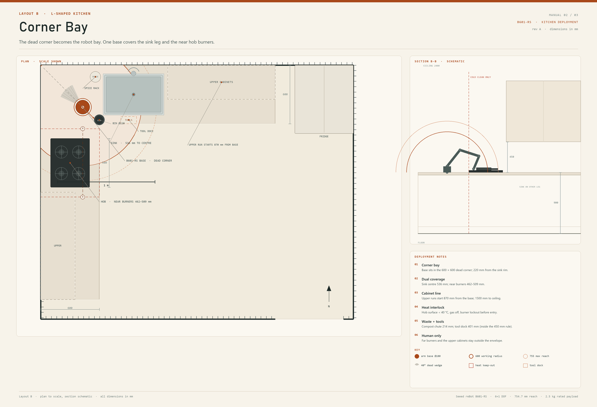
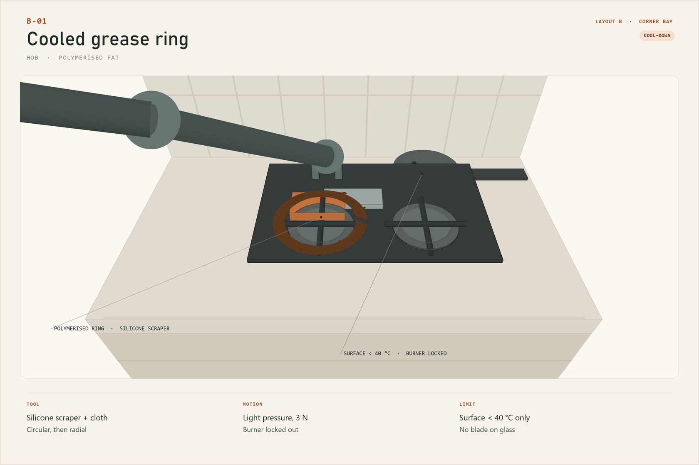
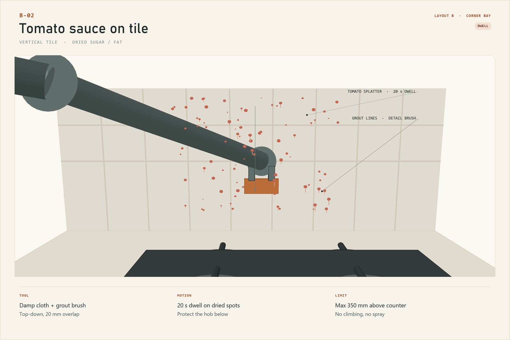
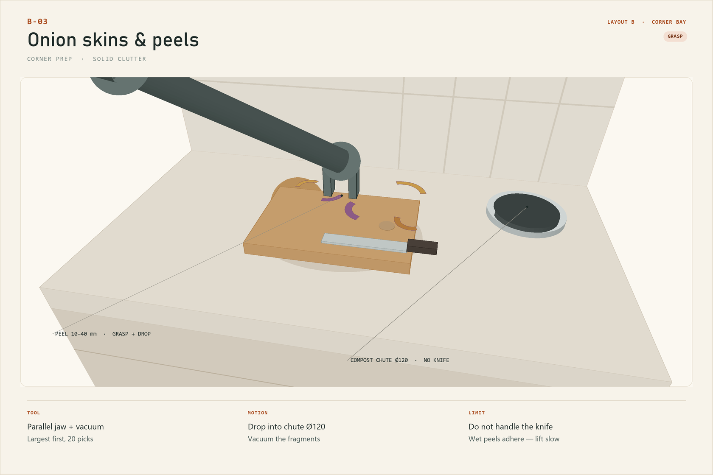
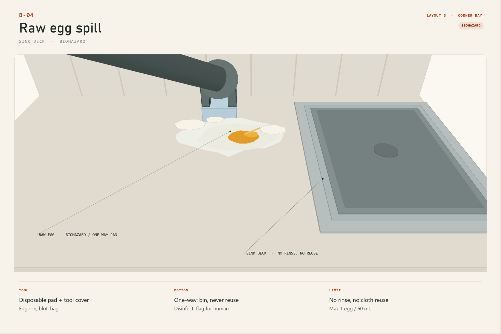
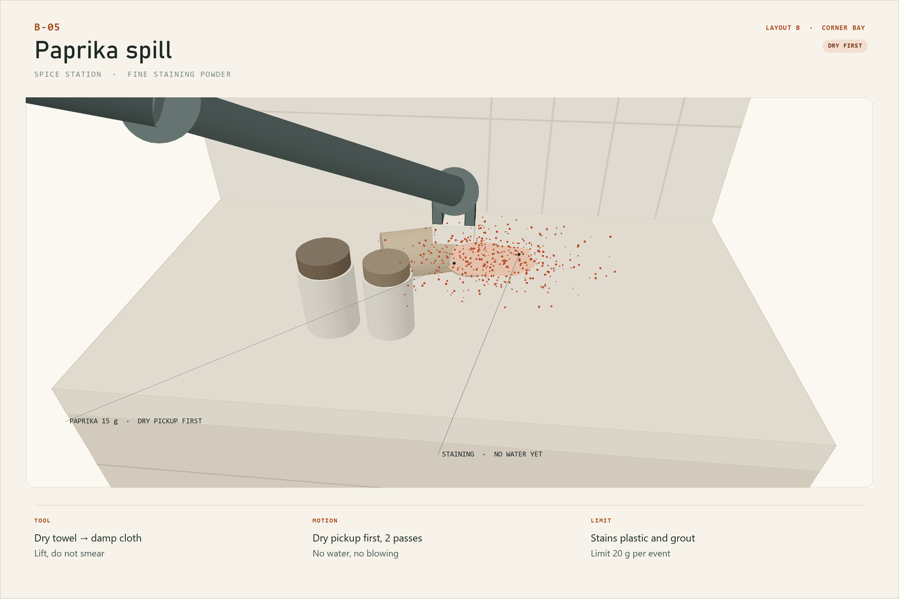

# Layout B — Corner Bay

> **L-shaped kitchen · fixed base in the dead corner · dual-leg coverage**
> Manual 02 of 03 · revision A · all dimensions in mm

The 600 × 600 corner of an L-shaped kitchen is usually dead space: too deep to
reach, too dark to store anything useful. This layout puts the arm there. One base
covers the sink leg and the near half of the hob leg, turning the worst corner in
the kitchen into the robot bay.

*Plan at scale with a 1 m scale bar; section is schematic. The red dashed line is
the cold-clean boundary at the hob; the hatched wedge faces the corner.*

## 1. At a glance

| | |
|---|---|
| Kitchen | L-shaped, 3200 × 2600 room, two 600 mm legs |
| Arm base | (430, 430), inside the 600 × 600 corner |
| Working radius | 600 mm (solid), 755 mm reserve |
| Covers | Sink leg, near hob burners, corner prep, chute, dock |
| Does not cover | Far hob burners (681–714 mm), upper cabinets, fridge |
| Best for | Widest task mix: wet, dry, greasy, biohazard, clutter |
| Mount | Counter base, through-bolted through the corner block |
| Mandatory extra | Hob heat interlock and burner lockout |

## 2. The idea

An L-shaped kitchen has two work fronts that meet at a corner nobody uses. The
sink sits on one leg, the hob on the other, and the corner between them is a
600 × 600 void. Put the base at (430, 430) and the geometry changes: the sink
centre is 536 mm away, the near burners are 462–509 mm away, and the corner
prep strip is under 300 mm. One arm now serves both legs.

The price is heat. Unlike Layout A, the arm's disc overlaps the hob. That is why
this layout is only allowed to run in a **cold-clean** mode: gas off, burners
locked, surface below 40 °C, and a 300 mm exclusion zone. The arm is a cleanup
tool, not a cooking assistant. If the hob is hot, the arm waits.

The corner also gives the layout two useful pieces of furniture that Layout A
does not have:

- a **compost chute** at (600, 560), 214 mm from the base, so onion skins and
  trimmings can be dropped without a trip to the bin;
- a **spice station** at (560, 120), 336 mm from the base, where the most common
  staining powder spill happens.

## 3. Envelope check

| Constraint | This layout | Verdict |
|---|---|---|
| Reach to sink centre | 536 mm | Comfortable |
| Reach to sink rim | 220 mm | Full articulation |
| Reach to near hob burners | 462–509 mm | Inside working radius |
| Reach to far hob burners | 681–714 mm | Reserve band only; human-only in practice |
| Reach to splashback behind hob | 536–926 mm | Corner end inside 600 mm; the rest is reserve/out of scope |
| Reach to spice station | 336 mm | Comfortable |
| Reach to compost chute | 214 mm | Comfortable |
| Reach to upper cabinets | 870 mm | Outside 755 mm |
| Heat exposure | Hob inside the disc | **Cold-clean only**; 300 mm exclusion |
| Base joint sector | 320° usable, 40° dead into corner | Pass |
| Payload, tool + residue | <0.5 kg | 20 % of rated payload |

> **Why the far burners are not assigned.** At 681–714 mm the arm is in the
> reserve band, close to full extension. The wrist is least stiff there, and a
> grease scraper needs a predictable normal force. The far burners are left to a
> human even when cold.

## 4. Placement

### 4.1 The base

- Position **(430, 430)**, centred in the 600 × 600 corner void. Plan coordinates are measured from the left wall (x) and the back wall (y).
- Footprint **Ø180 mm**; the corner block is reinforced with a 6 mm steel plate
  under the counter and four M6 through-bolts. The corner is the stiffest part of
  the run and the natural place for the cable to drop.
- The **40° dead wedge faces the corner** (−135°), so the cable and the service
  access sit in the void and the 320° usable sector faces the room.
- The base centre is **220 mm from the sink rim** and **536 mm from the sink
  centre**; **320 mm from the hob edge** and **462–509 mm from the near burners**.

### 4.2 Clearances

| Item | Requirement | Provided |
|---|---|---|
| Clear height above counter | 700 mm | 1500 mm to ceiling; no cabinet within 870 mm |
| Upper cabinet distance | ≥700 mm from base axis | 870 mm on both legs |
| Rear/corner clearance | 100 mm service | 150 mm in the void |
| Front clearance | 300 mm keep-clear | 1100 mm to the aisle |
| Hob exclusion | 300 mm while hot | 300 mm marked; interlocked |
| Tool dock | within 450 mm | 401 mm |
| Compost chute | within 300 mm | 214 mm |
| Spice station | within 400 mm | 336 mm |

The tool dock at 401 mm is inside the 450 mm dock rule: it is
still inside the working disc, but the arm has to turn to reach it. Keep the dock
clear of the sink splash zone; a wet dock is a slipping tool.

### 4.3 Services

- **48 V PSU** in the corner cabinet, on a bracket above the toe kick.
- **GFCI** and a **drip loop**; the corner is the lowest point of the run, so the
  cable entry is sealed and the PSU sits on the high side of the cabinet.
- **Gas / hob interlock:** a current sensor on the ignition circuit plus a
  thermocouple or IR sensor at the hob. The arm's program refuses to start if any
  burner is on or the surface is above 40 °C. For an induction hob, replace the gas
  valve with a contactor/isolator; the temperature check is unchanged.
- **E-stop** on the sink leg, reachable without entering the corner.
- **Compost chute:** 110 mm opening, gasketed lid, 6 L bin below. The arm drops;
  it does not open the lid. A human empties the bin.

## 5. Coverage map

| Zone | Distance from base | Task | Tool |
|---|---|---|---|
| Corner prep strip | 150–350 mm | Onion skins, spice spills | jaw, T5, T7 |
| Compost chute | 214 mm | Drop trimmings | jaw |
| Sink deck / near rim | 220–350 mm | Egg, shells, water | T2, T6, jaw |
| Sink centre | 536 mm | Light wipe only | T3 |
| Near hob burners | 462–509 mm | Cooled grease ring | T4, T3 |
| Splashback, corner end | 536–600 mm, 0–350 mm up | Tomato splatter | T3, T7 |
| Spice station | 336 mm | Paprika | T1, T3 |
| Far burners | 681–714 mm | **Human only** | — |
| Upper cabinets | 870 mm | **Human only** | — |

## 6. Five messes the arm can clear

### B-01 · Cooled grease ring on the hob

| Field | Value |
|---|---|
| Surface | Black glass hob, around one burner |
| Residue | Polymerised fat ring, 1–2 mm thick, 20–30 mm wide |
| Tool | T4 silicone scraper, then T3 with degreaser |
| Motion | Circular passes inside the ring, then radial; light pressure |
| Cycle | ~150 s, excluding cool-down |
| Limit | Surface <40 °C; burner locked; 3 N; no blade on glass |

**Why it fits the envelope.** The ring is at 462–509 mm, a comfortable working
distance. A silicone scraper is compliant enough to follow the glass and soft
enough not to scratch it. The arm's wrist torque is capped at 3 N of contact
force, which is exactly the range a polymerised ring needs after a 10 s degreaser
dwell.

**Method.** Confirm the burner is cold and locked. Apply degreaser to the cloth at
the dock and let it dwell 10 s. Scrape in circles inside the ring, then radially outward. Wipe with the
cloth and buff dry. The scraper never crosses the burner cap.

**Stop / escalate.** If the ring is carbonised black or thicker than 2 mm, stop.
The force needed is above the wrist limit, and a blade is not allowed on glass.

### B-02 · Tomato sauce on the splashback

| Field | Value |
|---|---|
| Surface | Glazed tile and grout behind the hob |
| Residue | Dried tomato sauce, 1–5 mm droplets, sugar + fat |
| Tool | T3 damp cloth, then T7 detail brush on grout |
| Motion | Top-down zig-zag, 20 mm overlap; 20 s dwell on dried spots |
| Cycle | ~100 s |
| Limit | Max 350 mm above counter; no spray; protect the hob below |

**Why it fits the envelope.** The corner end of the splashback is 536–600 mm from
the base and 0–350 mm above the counter, inside both the horizontal and vertical
envelopes. The dried sauce needs dwell time more than force: a wet cloth held for
20 s softens it, then the arm lifts rather than scrubs.

**Method.** Lay a dry towel over the hob below the work area (the arm can place
it). Wipe top-down with the damp cloth, dwell on each dried spot, then brush the
grout lines with T7. Finish with a dry buff.

**Stop / escalate.** Above 350 mm, or with an outlet within 300 mm, stop. Do not
spray: aerosol drift reaches the base and the hob igniter.

### B-03 · Onion skins and peels

| Field | Value |
|---|---|
| Surface | Corner prep strip and board |
| Residue | 10–40 mm dry skins, peels, stems; 15–25 pieces |
| Tool | Parallel jaw; T5 for fragments <5 mm |
| Motion | Largest first, 20 picks, drop into the chute |
| Cycle | ~120 s |
| Limit | Do not handle the knife; wet peels adhere — lift slowly |

**Why it fits the envelope.** The corner strip is 150–350 mm away, the chute is
214 mm. The pieces are light and irregular, which is exactly what a parallel jaw
with 120 mm stroke handles well. The chute is a fixed target, so the drop can be
repeatable without precision placement.

**Method.** Pick the largest pieces first, lift 40 mm, rotate to the chute, and
release. Dry skins release cleanly; wet peels need a slower lift and a small
sideways shear. Vacuum the fragments under 5 mm. Never pick the knife: it is
outside the allowed objects list even when it is inside the reach.

**Stop / escalate.** If the chute is full, stop and have it emptied. A blocked
chute is a jam risk for the next drop.

### B-04 · Raw egg on the sink deck

| Field | Value |
|---|---|
| Surface | Stainless sink deck |
| Residue | 1 raw egg, ~45 mL albumen + yolk, shell fragments |
| Tool | T6 disposable pad + tool cover, then disinfectant wipe |
| Motion | Edge-in, blot, bag; one-way disposal |
| Cycle | ~90 s |
| Limit | No rinse, no cloth reuse; max 1 egg / 60 mL; human verifies |

**Why it fits the envelope.** The spill is 220–350 mm from the base, on a flat
stainless deck. The arm can remove the bulk and apply disinfectant, but it cannot
guarantee sterilisation. This is the one task in the three manuals that ends with
a **human verification** step, not a robot-only success criterion.

**Method.** Fit a fresh tool cover and pad. Blot from the edge inward so the
albumen does not run into the sink cutout. Bag the pad and cover as one-way waste.
Wipe with disinfectant, let it dwell, then flag the zone for a human check.

**Stop / escalate.** Any spill that reaches the sink basin, the cabinet seam, or
the floor is a human job. Do not use a reusable cloth; do not rinse with the arm.

### B-05 · Paprika spill

| Field | Value |
|---|---|
| Surface | Quartz counter at the spice station |
| Residue | 10–20 g ground paprika, fine and staining |
| Tool | Dry paper towel or T1, then T3 damp |
| Motion | Dry pickup first, lift; 2 passes; then damp wipe |
| Cycle | ~60 s |
| Limit | No water first; no blowing; stains plastic and grout |

**Why it fits the envelope.** The spice station is 336 mm away, at the corner. The
powder is light and electrostatic, so the arm uses a dry lift rather than a wet
wipe: water turns paprika into a stain that spreads. A HEPA vacuum on T5 is the
fallback if the powder is loose.

**Method.** Dry-lift with a paper towel or brush, working from the outside in.
Change to a damp cloth and wipe the remaining film. Buff dry. Do not blow the
powder: it will coat the arm and the camera.

**Stop / escalate.** If the powder has been wetted and dried into the counter
seam, stop and treat it as a stain, not a spill.

## 7. A cleaning cycle

| Phase | Time | What happens |
|---|---|---|
| Heat check | 60 s | Burners off, surface <40 °C, gas isolated, 300 mm zone clear |
| Dry solids | 2 min | Onion skins, paprika, crumbs; chute and vacuum |
| Grease | 3 min | Cooled hob ring, then the tile behind it |
| Wet | 2 min | Sink deck, water, shells |
| Biohazard | 2 min | Raw egg last, one-way pad, disinfect, flag |
| Tools | 40 s | Disposable tools to waste; reusable tools to the wash queue |

Biohazard is last so the disposable tools do not contaminate the rest of the
cycle. The hob is cleaned before the sink so any grease that drops lands on a
surface that will be wiped afterwards.

## 8. Safety in this layout

- **Heat is the defining hazard.** The hob is inside the working disc. The arm
  must not start unless every burner is off, the gas is isolated, and the surface
  is below 40 °C. A 300 mm exclusion zone is marked and enforced in software.
- **Pan handles.** A pan on the hob can be inside the reach. Remove pans before a
  cycle; the arm is not allowed to grasp a pan handle.
- **Corner access.** The base is in the corner; the E-stop is on the sink leg, not
  behind the arm. Do not lean over the corner while the arm is enabled.
- **Water and power.** The corner is the low point. Seal the cable entry, use a
  drip loop, and keep the PSU on a bracket above the cabinet floor.
- **Biohazard.** Raw egg is a one-way task. Disposable pad, tool cover, bag,
  disinfectant, human verification. No reusable cloth.
- **Knife.** The knife is never picked, even when it is within reach.

## 9. Out of scope here

- Any hob work while a burner is hot, or while gas is on.
- The oven, the range hood, and the floor.
- The far burners in the reserve band.
- Pan handles, hot pans, and the wok.
- The knife and the knife block.
- Sterilising raw egg or raw poultry; the arm removes bulk and disinfects, a
  human verifies.
- Emptying the compost bin or changing the vacuum bag.

## 10. Install checklist

1. Reinforce the corner: 6 mm steel plate under the counter, four M6 through-bolts.
2. Bolt the base at (430, 430); torque to 8 Nm; check the corner for rocking.
3. Fit the compost chute at (600, 560) with a 110 mm opening and a gasketed lid.
4. Fit the tool dock at (820, 525), 401 mm from the base; keep it dry.
5. Fit the PSU above the cabinet floor; GFCI; drip loop; sealed cable entry.
6. Install the hob interlock: current sensor + IR/thermocouple; test the refusal.
7. Mark the 300 mm exclusion zone around the hob with removable tape.
8. Mount the camera at 1.9 m, 30° down, looking into the corner; calibrate.
9. Run a cold dry cycle; then a 3 N wipe on a scrap tile; log the force peak.
10. Verify the upper runs start 870 mm from the base on both legs.

## 11. Bill of materials

| Item | Qty | Note |
|---|---|---|
| reBot B601-RS assembled arm | 1 | 6+1 DOF |
| 48 V / 12.5 A PSU | 1 | Corner cabinet, high side |
| Base plate, 200 × 200 × 6 steel | 1 | Corner reinforcement |
| M6 × 60 stainless bolts | 4 | 8 Nm |
| Compost chute kit, 110 mm | 1 | Gasketed lid, 6 L bin |
| Tool dock, 8 slots | 1 | 401 mm from base |
| Tools T1–T8 | 1 set | <300 g each |
| Hob interlock: current sensor + IR/thermocouple | 1 | Refuses start when hot |
| Gas isolation / smart valve | 1 | Cold-clean mode |
| RGB-D camera | 1 | Corner view, 1.9 m |
| GFCI + drip loop + sealed entry | 1 | Low-point protection |
| Disposable pads, tool covers, disinfectant | — | Biohazard kit |

## 12. Maintenance

| Interval | Task |
|---|---|
| Each cycle | Empty the chute; dispose of one-way tools; wipe the sink deck |
| Daily | Check the hob interlock with a warm cup; inspect the corner bolts |
| Weekly | Clean the camera; check the chute gasket; verify the exclusion tape |
| Monthly | Re-check the 3 N force cap on glass; test the gas isolation |
| After raw egg | Dispose of pad and cover; disinfect; log the human verification |
| Every 6 months | Re-torque the base; inspect the corner plate for corrosion |

