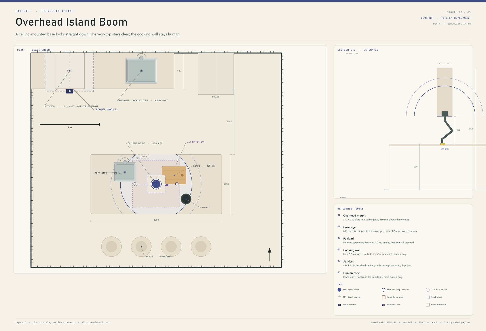
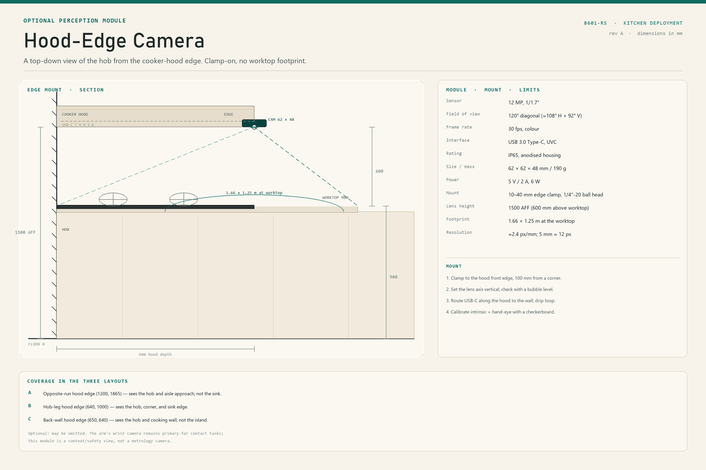
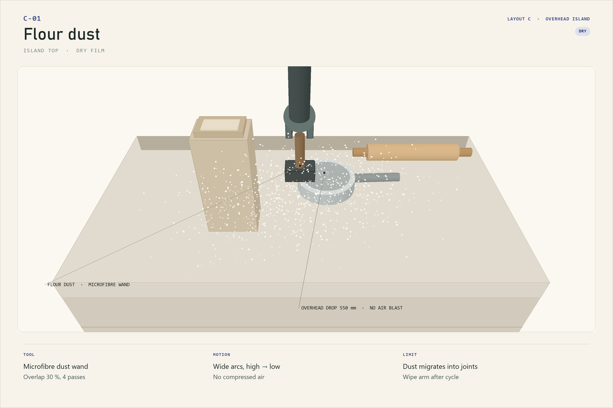
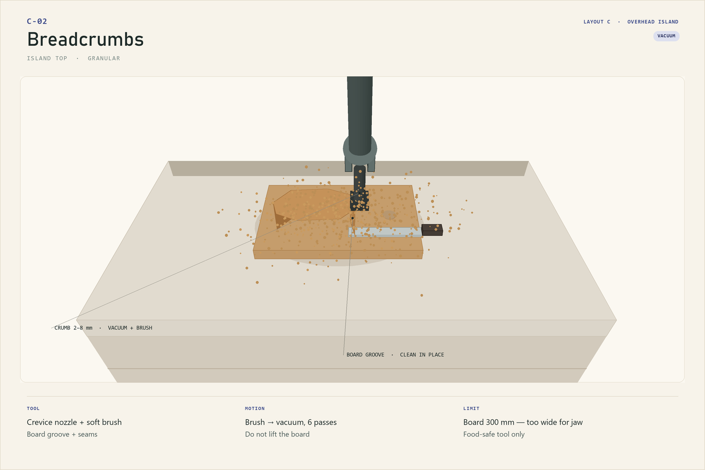
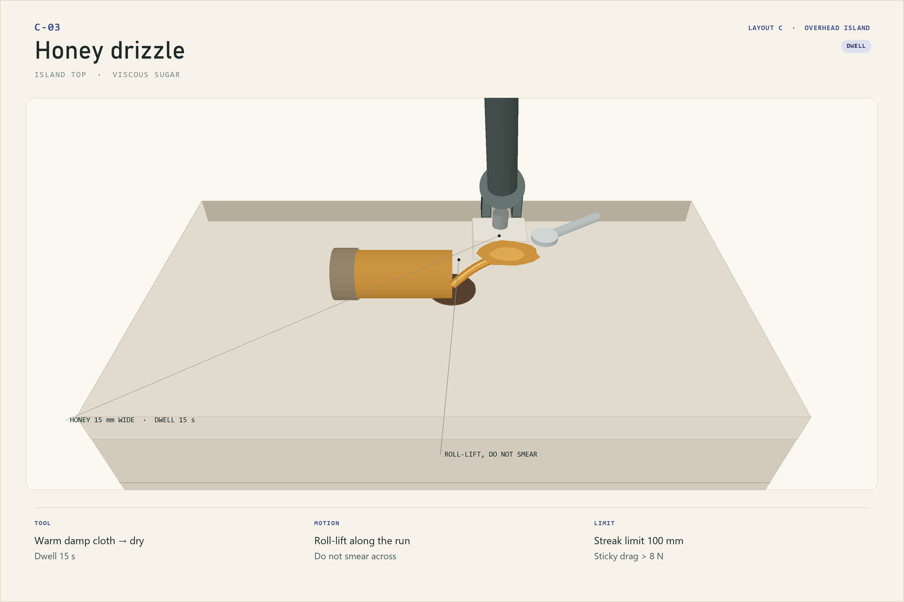
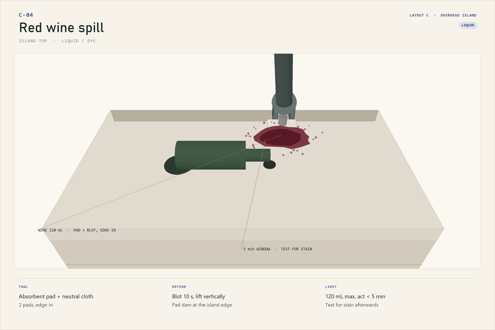
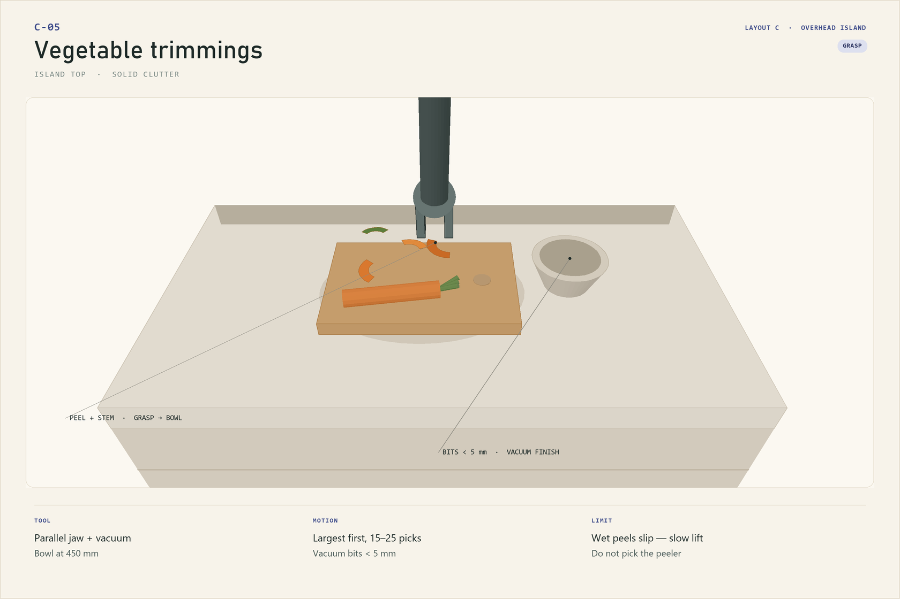

# Layout C — Overhead Island Boom

> **Open-plan island · inverted ceiling mount · zero worktop footprint**
> Manual 03 of 03 · revision A · all dimensions in mm

The arm hangs from a soffit above the island and looks straight down. Nothing
touches the worktop, the island ends stay free for people, and the downward
approach is the arm's most natural cleaning pose. The trade is payload and
headroom: an inverted arm is derated, and the space under it must stay clear.

*Plan at scale with a 1 m scale bar; section is schematic. The mount is at 1450
above the floor, 550 mm above the 900 mm worktop. The 600 mm disc is clipped to
the island; the cooking wall is 2.2 m away.*

## 1. At a glance

| | |
|---|---|
| Kitchen | Open-plan, 4200 × 3600 room |
| Island | 2200 × 1000 at (1000, 1700) |
| Arm mount | Ceiling/soffit at (2100, 2200), 1450 above floor |
| Working radius | 600 mm on the worktop; 550 mm vertical clearance |
| Covers | Central prep disc: prep sink, board, chute |
| Does not cover | Island ends (1100 mm), stools, cooking wall (2.2 m) |
| Best for | Baking and prep mess, downward wiping, clear worktop |
| Mount | 300 × 300 plate into joists; 950 mm soffit drop; mount 550 mm above worktop |
| Payload | Derated to **1.0 kg** when inverted |

## 2. The idea

An island is the one kitchen topology where a ceiling mount makes sense. The
worktop is freestanding, so there is no wall to bolt to and no upper cabinet to
hide behind. A 300 × 300 plate on the ceiling joists, a short soffit, and the arm
hangs over the centre of the island. The worktop stays completely clear: no base,
no cable on the counter, no tool bay eating 250 mm of prep space.

The arm's disc is 1200 mm across, and the island is 2200 mm long. That is a
deliberate mismatch. The arm owns the **central prep disc**: prep sink, board,
compost chute. The two ends of the island — the plating end and the seating end —
stay human. The hob and the main sink sit on the back wall, 1.9–2.4 m away, so the arm
never sees heat or a basin it cannot enter.

The downward pose is also the best pose for cleaning a flat surface. Gravity
pulls the tool into the worktop, the wrist does not have to hold the forearm out
sideways, and the camera sees the mess without the arm crossing its own view. The
cost is that the arm hangs over people's heads: the 550 mm gap between the mount
and the worktop is a hard keep-out, and the tool tethers are mandatory.

## 3. Envelope check

| Constraint | This layout | Verdict |
|---|---|---|
| Reach to prep sink centre | 562 mm | Inside 600 mm working radius |
| Reach to board centre | 335 mm | Comfortable |
| Reach to compost chute | 559 mm | Inside working radius |
| Reach to island ends | 1100 mm | Outside 755 mm — human only |
| Reach to cooking wall | 2200 mm | Outside 755 mm — human only |
| Vertical clearance, mount to worktop | 550 mm | Arm fits; people must not |
| Payload, inverted | 1.0 kg derated | Tool + residue <0.5 kg |
| Headroom under the arm | 550 mm at the disc | No seated person; stools outside |
| Water above electronics | Prep sink 562 mm from mount | Drip loop, no spray |
| Mount structure | 300 × 300 plate into joists | 4 × M8, rated for 4× arm mass |

> **Why derate to 1.0 kg?** The published 2.5 kg rating assumes an upright base.
> Inverted, the arm holds its own links against gravity all the time, and the
> vendor does not publish an inverted rating. Until the vendor confirms one, the
> deployment caps tool + residue at 1.0 kg. That is still 2× the heaviest tool in
> the set.

## 4. Placement

### 4.1 The mount

- **300 × 300 × 8 mm** steel plate through-bolted to two ceiling joists with
  4 × M8 × 120 lag bolts. Do not fix to plasterboard or a suspended ceiling grid.
- **Soffit drop** of 950 mm from a 2400 mm ceiling to the mount face at 1450 mm.
  The drop is a 300 × 300 boxed section, painted to match the ceiling; the cable
  runs inside it.
- Mount centre at **(2100, 2200)**, the island's geometric centre. Plan coordinates are measured from the left wall (x) and the back wall (y). The arm's
  base is inverted; the dead wedge faces up into the soffit, so the 320° usable
  sector is available at the worktop.
- **550 mm** from the mount face to the 900 mm worktop. The arm's folded length is
  under 550 mm; the tool can reach the worktop with the wrist near straight.

### 4.2 Clearances and keep-outs

| Item | Requirement | Provided |
|---|---|---|
| Worktop to mount | 550 mm | 550 mm |
| Tool drop zone | Tether + 300 mm clear | Tools tethered; island centre clear |
| Stools | Outside the 600 mm disc | Stools at y = 3250, 450 mm from the disc edge |
| Island ends | Human only | 1100 mm from the mount |
| Cooking wall | Outside 755 mm | 2200 mm |
| Camera | Above the arm, looking down | Ceiling, offset 300 mm |
| Vacuum hose | Supported, not wrist-loaded | Ceiling boom, 0.2 kg at the tool |

### 4.3 Services

- **48 V PSU** in the island cabinet, on a bracket above the toe kick.
- **Cable** up through the soffit, with a **drip loop** at the island cabinet and a
  strain relief at the mount. Nothing runs across the worktop.
- **E-stop** on the island end, at 1100 mm, outside the disc.
- **Tool dock** on the island's north edge, within 600 mm of the mount; tools are
  tethered to the dock, not to the arm.
- **Vacuum** canister in the island cabinet; hose through the soffit on a boom.

### 4.4 Optional hood camera

A 12 MP, 120° module clamps to the front edge of the back-wall hood at
**(650, 640)**, lens at **1500 AFF**. It covers the **hob and cooking wall**, not
the island worktop behind it. In this layout it is a cooking/safety view; the
ceiling camera above the arm remains the primary view for cleaning.

| Item | Value |
|---|---|
| Module | 12 MP, 1/1.7", 120° diagonal, 30 fps, USB 3.0 UVC, IP65 |
| Size / mass | 62 × 62 × 48 mm / 190 g |
| Mount | 10–40 mm edge clamp, 1/4"-20 ball head, lens axis vertical |
| View at worktop | 1.66 × 1.25 m, ≈2.4 px/mm (5 mm ≈ 12 px) |
| Cable | USB-C along the hood to the wall; 5 V 2 A; drip loop; strain relief |
| Calibration | intrinsic + hand-eye to the base; checkerboard on the hob |
| Privacy | local UVC only; LED when active; no cloud by default |

Optional. If the ceiling camera already covers the island, this module adds
cooking-zone context only; it does not improve the arm's reach or accuracy.

### 4.5 Alternative: soffit-edge camera

Layout C has no wall upper cabinets near the island, so the alternative is the
**bottom edge of the overhead cabinet/soffit** at **(2250, 2200)**, lens **1450
AFF**, looking straight down with a view rectangle of 1700–2500 × 1800–2600. This
is the best **arm-motion** view in Layout C: it sees the links, the tool, and the
island disc from above. It does not see the back-wall hob, and it must not reduce
the 550 mm clearance or hang into the arm's disc.

| Item | Value |
|---|---|
| Mount | bottom edge of the soffit/overhead cabinet; 10–40 mm clamp |
| Lens height | 1450 AFF (550 mm above worktop) |
| View at worktop | ≈1.5 × 1.1 m, centred on the arm disc |
| Cable | USB-C through the soffit; drip loop; strain relief |
| Trade-off | sees arm, not hob; tool can pass close to the lens |

## 5. Coverage map

| Zone | Distance from mount | Task | Tool |
|---|---|---|---|
| Board centre | 335 mm | Crumbs, flour, trimmings | T1, T5, jaw |
| Board near edge | 250–450 mm | Wipe, scrape | T2, T4 |
| Prep sink deck | 500–600 mm | Water, shells, scraps | T2, T6, jaw |
| Compost chute | 559 mm | Drop trimmings | jaw |
| Island centre | 0–600 mm | Honey, wine, dust | T3, T6 |
| Island ends | 1100 mm | **Human only** | — |
| Stools / seating | 450 mm from disc | **Human only** | — |
| Cooking wall | 2200 mm | **Human only** | — |

## 6. Five messes the arm can clear

### C-01 · Flour dust

| Field | Value |
|---|---|
| Surface | Island quartz, board, sieve, flour bag |
| Residue | 5–15 g settled flour dust, 0.1–0.5 mm film |
| Tool | T1 soft brush or microfibre wand |
| Motion | Wide overlapping arcs, high edges → centre, 30 % overlap, 4 passes |
| Cycle | ~80 s |
| Limit | No compressed air; dust migrates into the wrist joints |

**Why it fits the envelope.** The dust is directly under the mount, 0–450 mm from
the disc centre. The downward approach lets the brush work with gravity, and the
camera sees the whole island without the arm in the way. The residue is light
enough that the 1.0 kg inverted payload is irrelevant.

**Method.** Start at the island's far edge and work toward the centre with wide
overlapping arcs. Brush the sieve and the flour bag seam, then wipe the arm's
wrist with a dry cloth before stowing: flour in the wrist is the main long-term
wear item in this layout.

**Stop / escalate.** Do not use compressed air. It coats the camera, the mount,
and the joints, and the cleanup takes longer than the original spill.

### C-02 · Breadcrumbs

| Field | Value |
|---|---|
| Surface | Board and island top, board groove |
| Residue | 2–8 mm crumbs, 5–15 g |
| Tool | T5 crevice nozzle + T1 brush |
| Motion | Brush from the board into a pile, vacuum the seam, 6 passes |
| Cycle | ~70 s |
| Limit | Board is 300 mm wide — too wide for the jaw; clean in place |

**Why it fits the envelope.** The board is 335 mm from the mount, fully inside the
disc. The arm cannot lift the board (the jaw opens 120 mm), so the task is designed
as a clean-in-place operation: brush, pile, vacuum. The board's groove is the only
place that needs the detail tool.

**Method.** Brush the board's surface toward its centre, then vacuum the groove and
the board's edge. Lift the board's handle end 10 mm with a jaw if needed to reach
under it — never lift it clear; the jaw cannot span it.

**Stop / escalate.** If the board is wet or the crumbs have been pressed into the
wood, stop. The arm cannot scrub a board without raising the grain.

### C-03 · Honey drizzle

| Field | Value |
|---|---|
| Surface | Island quartz |
| Residue | 10–20 g honey, 10–15 mm wide run |
| Tool | T3 warm damp cloth, then dry cloth |
| Motion | Dwell 15 s, roll-lift along the run, 4 passes |
| Cycle | ~90 s |
| Limit | 100 mm run; sticky drag above 8 N; do not smear across |

**Why it fits the envelope.** Honey is a force problem, not a reach problem. The
arm's 3–5 N contact cap is enough to press a warm cloth, but not enough to drag a
long sticky run. The 100 mm limit is set by the measured drag: beyond that, the
cloth rolls off the tool or the wrist stalls.

**Method.** Lay the warm damp cloth on the run, dwell 15 s, then roll-lift along
the run rather than wiping across it. Change to a dry cloth and buff. The cloth is
discarded, not returned to the dock.

**Stop / escalate.** A run longer than 100 mm, or honey that has crystallised, is a
human job. Do not add water: it spreads the sugar.

### C-04 · Red wine spill

| Field | Value |
|---|---|
| Surface | Island quartz |
| Residue | 120 mL red wine, dye + acid |
| Tool | T6 absorbent pad + T3 neutral cloth |
| Motion | Pad dam at the edge, blot 10 s, lift vertically, 2 pads |
| Cycle | ~60 s |
| Limit | 120 mL max; act within 5 min; test for stain afterwards |

**Why it fits the envelope.** The spill is 400–600 mm from the mount, inside the
disc. The arm cannot rinse, but it can dam and blot. The 5 min limit is a stain
limit, not an arm limit: quartz stains if the wine is left, and the arm is slower
than a human with a towel.

**Method.** Place the first pad at the island edge as a dam, then blot from the
edge inward. Lift vertically; do not wipe. Repeat with a second pad, then wipe
with the neutral cloth and buff. Log the elapsed time and flag any residual
colour for a human stain check.

**Stop / escalate.** More than 120 mL, or wine that has run off the island edge, is
a human job. The arm must not chase liquid over the edge.

### C-05 · Vegetable trimmings

| Field | Value |
|---|---|
| Surface | Board, island top, bowl |
| Residue | 15–25 pieces of peel, stem, carrot ends; 5–60 mm |
| Tool | Parallel jaw; T5 for bits <5 mm |
| Motion | Largest first, 15–25 picks, drop into the bowl or chute |
| Cycle | ~100 s |
| Limit | Wet peels slip — slow lift; do not pick the peeler |

**Why it fits the envelope.** The board is 335 mm away, the chute 559 mm. The
pieces are light and irregular; the jaw handles the large ones, the vacuum handles
the small ones. The bowl is a fixed target, so the drop can be repeatable.

**Method.** Pick the largest pieces first. For wet peels, lift slowly and add a
small sideways shear to release surface tension. Vacuum the bits under 5 mm.
Never pick the peeler: it is a sharp edge and outside the allowed object list.

**Stop / escalate.** If the bowl or chute is full, stop. A blocked drop is a jam
risk and the arm cannot clear it.

## 7. A cleaning cycle

| Phase | Time | What happens |
|---|---|---|
| Pre-flight | 30 s | Island clear; stools back; no person under the arm; tools tethered |
| Dry | 2 min | Flour dust, crumbs, trimmings; brush and vacuum |
| Viscous | 2 min | Honey, then any sticky film |
| Liquid | 2 min | Wine, water rings; pad and blot |
| Buff | 30 s | Dry cloth on the board and island centre |
| Tools | 30 s | Tools back to the tethered dock; one-way pads to waste |

The order is dry → viscous → liquid, so water never turns dry residue into paste
and honey never contaminates the dry brush.

## 8. Safety in this layout

- **Overhead crush and pinch.** The arm hangs at 1450 mm, 550 mm above the
  worktop. No one puts their head or hands under the disc while it is enabled.
  The stools are outside the disc; the island ends are the safe working zones.
- **Tool drop.** Every tool is tethered to the dock or the wrist. The arm parks
  over the island centre, never over a person, and drop detection stops the cycle.
- **Power loss.** The arm's brakes hold; the park pose is over the island, not over
  the edge. Do not stand under the arm during a power cut.
- **Water above electronics.** The prep sink is 562 mm from the mount and the PSU
  is in the island cabinet. No spray; drip loop at the cabinet; sealed cable entry
  at the soffit.
- **Inverted gravity.** The arm's own links are a continuous load. The 1.0 kg
  payload derate, gravity feedforward, and a 20 % torque margin are all mandatory.
- **Mount structure.** The 300 × 300 plate is rated for 4× the arm mass. Inspect
  the lag bolts monthly; vibration loosens them.
- **Camera.** Local processing only; LED when active. The hood camera looks at the
  back-wall hob; the soffit camera looks at the arm; the ceiling camera above the
  arm remains primary. None is a safety-rated stop.

## 9. Out of scope here

- The island ends, the stools, and the floor.
- The back-wall hob, oven, and main sink (2.2 m away).
- The prep sink basin interior and the drain.
- Lifting the board, the bowl, or the flour bag.
- The peeler, knives, and the wine bottle.
- Any task that requires reaching above the mount or behind the soffit.

## 10. Install checklist

1. Verify two ceiling joists under the mount location; no plasterboard-only fixing.
2. Fit the 300 × 300 × 8 steel plate with 4 × M8 × 120 lag bolts; torque to spec.
3. Build the 300 × 300 soffit drop to 1450 mm; route the cable inside.
4. Mount the arm inverted; check the dead wedge faces up into the soffit.
5. Fit the PSU in the island cabinet; drip loop; sealed entry at the soffit.
6. Fit the tethered tool dock on the island's north edge, within 600 mm.
7. Fit the vacuum canister and boom; hose weight at the tool <200 g.
8. Mount the camera above the arm, offset 300 mm; calibrate hand–eye.
9. Load-test the mount with 4× the arm mass; check for deflection.
10. Run a 1.0 kg payload test at full down reach; verify the torque margin.
11. *(Optional)* Choose one camera: hood at (650, 640), or soffit-edge at (2250, 2200); set the lens, calibrate.

## 11. Bill of materials

| Item | Qty | Note |
|---|---|---|
| reBot B601-RS assembled arm | 1 | Inverted |
| Ceiling plate, 300 × 300 × 8 steel | 1 | 4 × M8 lag bolts |
| Soffit drop, 300 × 300 × 950 | 1 | Cable route inside |
| 48 V / 12.5 A PSU | 1 | Island cabinet |
| Tethered tool dock, 8 slots | 1 | North edge |
| Tools T1–T8 | 1 set | <300 g, tethered |
| Vacuum canister + boom + hose | 1 | Tool weight <200 g |
| RGB-D camera | 1 | Above the arm, 300 mm offset |
| Optional hood camera (12 MP, 120°, USB 3.0, IP65) | 1 | Back-wall hood edge, 1500 AFF |
| Hood-edge clamp + 1/4"-20 ball head | 1 | 10–40 mm flange; lens axis vertical |
| Alternative soffit-edge bracket + 30° wedge | 1 | If the soffit camera is chosen |
| USB-C cable, 5 V 2 A supply, strain relief | 1 | Along hood; drip loop |
| Drop detection / tool tether kit | 1 | Mandatory |
| GFCI + drip loop | 1 | Island cabinet |
| Disposable pads, cloths, neutral cleaner | — | Consumables |

## 12. Maintenance

| Interval | Task |
|---|---|
| Each cycle | Wipe the wrist; check the tool tethers; empty the chute |
| Daily | Inspect the mount bolts for movement; check the cable at the soffit |
| Weekly | Clean the ceiling, hood, and soffit camera lenses; check both clamps; check the vacuum hose; verify the park pose |
| Monthly | Re-torque the mount; re-run the 1.0 kg payload test; check the brakes |
| After wine or honey | Discard the cloth; clean the tool handle; log |
| Every 6 months | Inspect the ceiling plate and joists; re-calibrate gravity feedforward |

